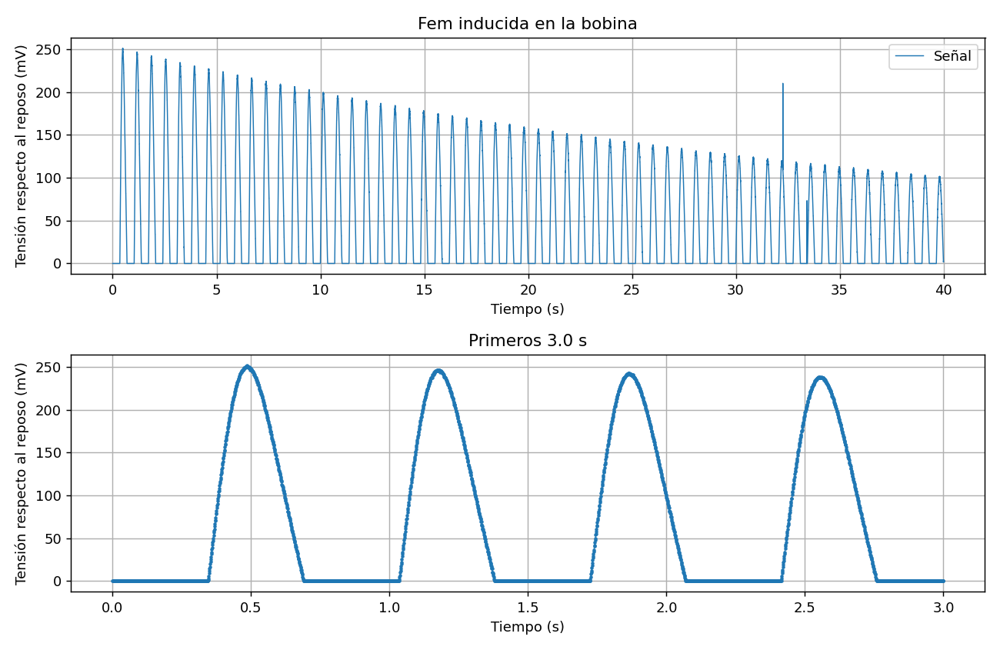
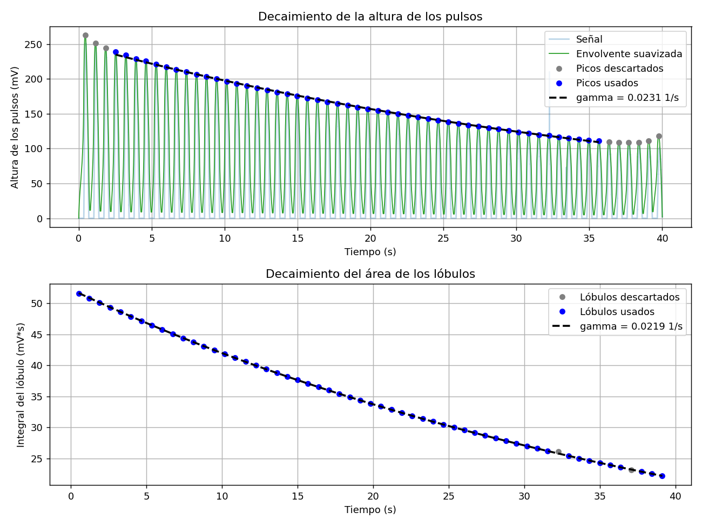

# Oscilaciones de un imán en un resorte: análisis de la fem inducida

Un imán colgado de un resorte oscila sobre una bobina. La tensión inducida en la bobina se registra con un ESP32, y `spring_magnet_analyzer.py` obtiene de ese registro la frecuencia de oscilación, el coeficiente de amortiguamiento γ y la variación del campo medio B_eq sobre la bobina. Si además se conoce la masa que oscila, la constante k del resorte o el coeficiente de amortiguamiento b (basta uno de los tres), el programa calcula los otros dos.

Todo lo que el programa necesita se escribe en un archivo, `config.json`, que está junto al script; entre otras cosas, cuántos segundos dura la captura con el ESP32. No hace preguntas al ejecutarse. El notebook de `notebooks/` explica el método y lo comprueba con registros simulados.



Las figuras de este repositorio salen de un registro simulado, no de mediciones.

## Uso rápido

```
pip install -r requirements.txt
python spring_magnet_analyzer.py
```

Con el `config.json` incluido, el programa analiza un registro simulado de 40 s y guarda los resultados en `resultados/<fecha_hora>/`: el informe (`.txt` y `.json`), cuatro gráficas, el registro crudo y una copia del `config.json` usado.

## Datos propios

Para analizar datos propios se edita `config.json`. Con un registro ya guardado:

```json
"fuente": { "tipo": "archivo", "archivo": "datos/medicion_raw_20260204_151040.csv" },
"montaje": { "vueltas": 1500, "radio_mm": 30, "masa_g": 150 }
```

Con el ESP32 conectado se captura un registro nuevo (requiere `pip install pyserial`). `duracion_s` fija cuántos segundos dura la captura y `cuenta_regresiva_s`, los segundos de aviso antes de empezar, para tener el imán listo:

```json
"fuente": { "tipo": "serie", "duracion_s": 30, "cuenta_regresiva_s": 5 }
```

Los valores de `montaje` de estos ejemplos son ilustrativos: se escriben los del montaje propio, y `null` en los datos que no se conocen. Con datos reales, k, b y B_eq solo se calculan si se escriben esos datos. El [manual](MANUAL.md) explica el montaje, la calibración, la medición y cada clave del archivo.

## Ejemplo de salida

Registro simulado con valores conocidos (`examples/resultados_demo/informe.txt`):

```
Medido en el registro
  frecuencia f0                                    1.450 +/- 0.025 Hz    resolución, FWHM / 2
  gamma, área de los lóbulos (*)           0.0218696 +/- 0.0000071 1/s   R2 = 1.0000
  gamma, altura de los pulsos                0.023120 +/- 0.000078 1/s   R2 = 0.9995, 49 picos
  integral de la fem del lóbulo mayor      0.0515775 +/- 0.0000090 V*s   t = 0.34 a 0.69 s

Con los datos del montaje
  masa efectiva                                                0.2 kg    dada
  constante del resorte k                           16.60 +/- 0.58 N/m   m * omega0^2
  coeficiente de amortiguamiento b         0.0087478 +/- 0.0000028 kg/s  2 m gamma
  variación del campo medio B_eq               2.80372 +/- 0.00049 mT    solo ruido de lectura

Comparación con los valores verdaderos del simulador
  magnitud                       calculado     verdadero  diferencia
  gamma (1/s)                      0.02187         0.022       -0.6 %
  k (N/m)                           16.601          16.6       +0.0 %
  B_eq (T)                       0.0028037     0.0028035       +0.0 %
```



## Contenido

```
spring_magnet_analyzer.py        el programa
config.json                      datos y parámetros; se edita antes de ejecutar
requirements.txt                 dependencias
MANUAL.md                        guía de laboratorio
notebooks/                       informe del método, con datos simulados
firmware/esp32_adc_serial/       sketch del ESP32
examples/                        registro simulado y resultados de la demo
tests/                           pruebas automáticas
```

Las pruebas se ejecutan con `python -m unittest discover -s tests`. No necesitan hardware; incluyen una captura completa con un ESP32 simulado.

## Estado y límites

- No se conservan los datos medidos con el montaje físico. El programa se validó con registros simulados que conocen sus valores verdaderos, y la captura por puerto serie, incluida una medición completa de principio a fin, con un ESP32 simulado. Falta una prueba con el ESP32 conectado. Se probó con Python 3.12, NumPy 2.4, SciPy 1.17 y Matplotlib 3.10 en Linux; la demo también se ejecutó completa en Windows (PowerShell, entorno de conda). El código no usa sintaxis posterior a Python 3.9.
- El ADC del ESP32 no mide tensiones negativas, así que con la conexión directa solo se registra el lóbulo positivo de cada ciclo. Además, su respuesta cerca de 0 V no es fiable: en el simulador, una zona muerta de 100 mV con pulsos de 250 mV reduce B_eq a menos de la mitad y multiplica γ por 3.5. La sección 6 del manual explica cómo detectarlo y evitarlo.
- γ estima el decaimiento de la altura o del área de los pulsos, y solo coincide con el de la amplitud de oscilación si los pulsos conservan su forma. El programa avisa cuando las dos estimaciones difieren.
- B_eq es la variación del campo medio sobre la bobina entre los dos extremos de la oscilación, con campo uniforme supuesto sobre su área. Crece con la amplitud y no es el campo del imán en un punto; solo se pueden comparar registros soltados desde la misma amplitud.
- Si el equilibrio del imán está en el plano de la bobina, la frecuencia medida es el doble de la mecánica y k sale cuatro veces mayor. Escribir la constante k medida de forma estática junto a la masa permite detectarlo (sección 10 del manual).

## Autores

Cristian Vergara, Juan Palacio, Sofía Moscoso y Francisco Gonzales. Universidad de Antioquia.
