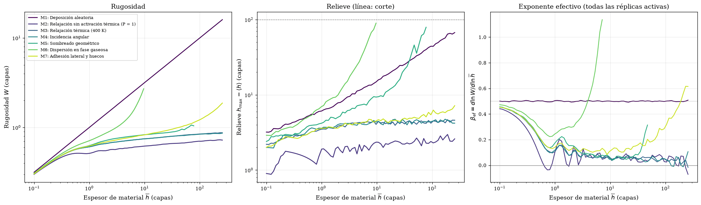
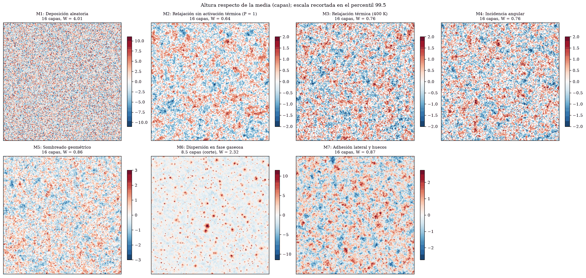
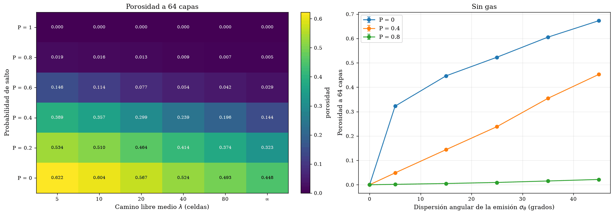
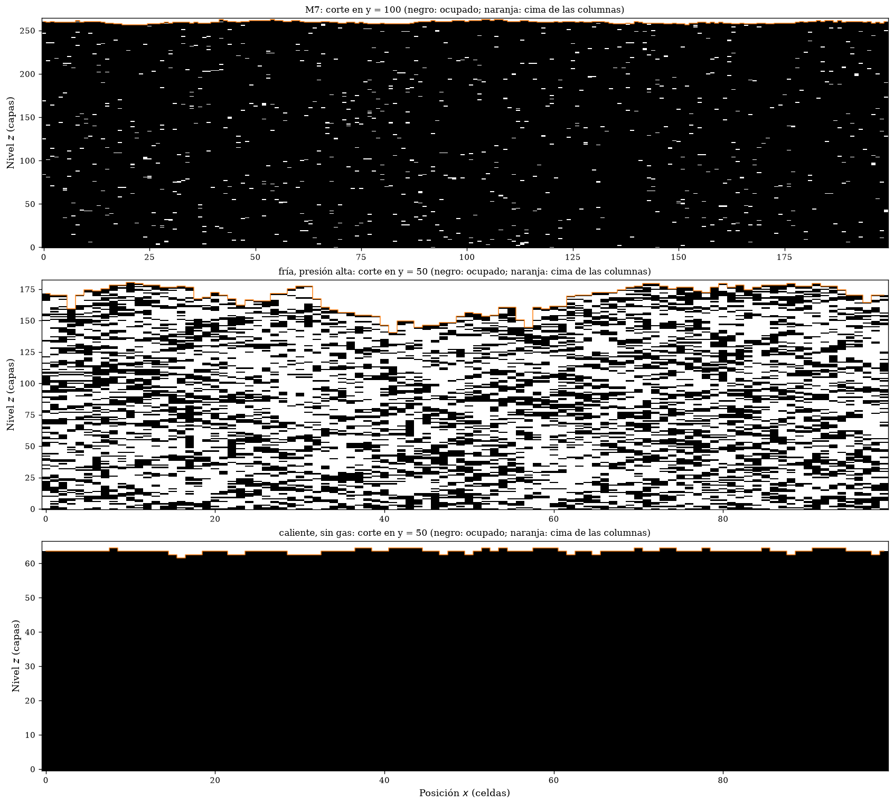
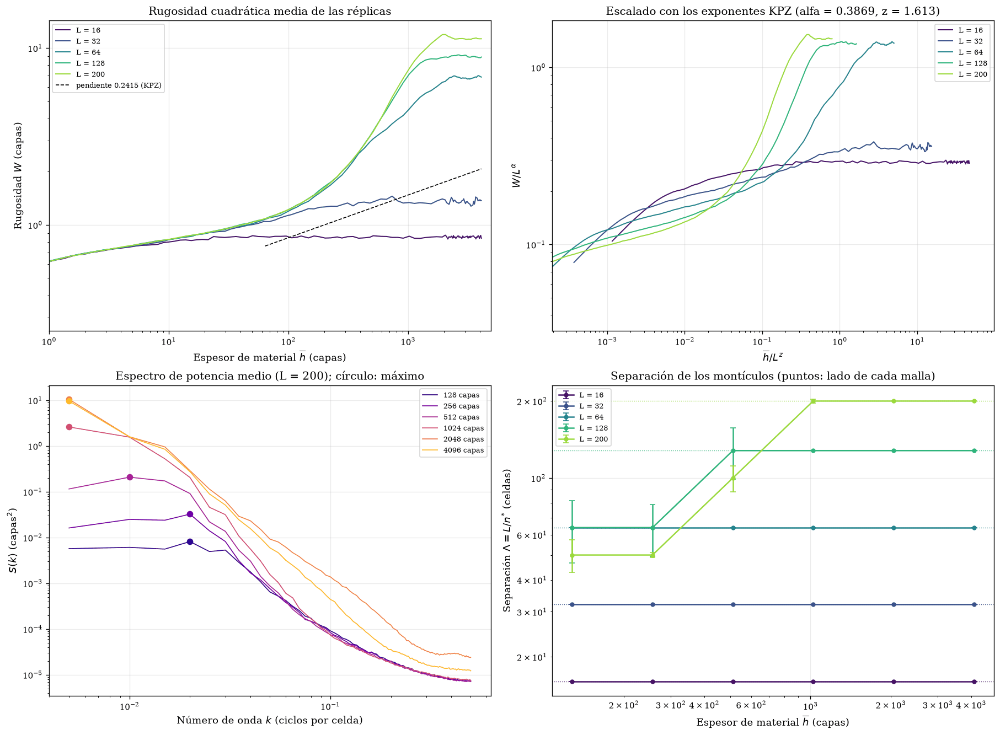

# Crecimiento de películas delgadas de Cu por Monte Carlo

**Abstract.** This project builds, one mechanism at a time, a kinetic Monte Carlo model of the growth of a copper thin film deposited by thermal evaporation. Eight Jupyter notebooks share a single simulation engine on a periodic lattice with one height per column. Starting from random deposition, the chain adds downhill surface relaxation, a temperature-dependent hopping probability, oblique incidence, geometric shadowing traced exactly cell by cell, collisions with the residual gas and lateral sticking, which leaves closed voids in the film. Each model reduces exactly to the previous one when its new mechanism is switched off. In every notebook, hypotheses and acceptance criteria are stated before the experiments are run and are then tested on independent replicas. The analysis covers dynamic scaling and universality classes (random deposition, Edwards–Wilkinson and Kardar–Parisi–Zhang), the column instability caused by shadowing, porosity and density profiles, and a $2^5$ factorial design of the five transport and incorporation mechanisms. The results describe the model, which is not calibrated against measurements on copper films. The notebooks are written in Spanish.

Ocho cuadernos de Jupyter que construyen, mecanismo a mecanismo, un modelo de Monte Carlo del crecimiento de una película delgada de cobre depositada por evaporación térmica. Cada cuaderno añade un mecanismo al modelo del anterior: el modelo M$k$ contiene al M$(k-1)$, que se recupera exactamente al apagar el mecanismo nuevo. El séptimo modelo reúne todos los mecanismos, y el último cuaderno compara los siete. El código que comparten los cuadernos está en el paquete `thinfilm_mc`.

El estudio es computacional. No se compara con medidas de películas de Cu, y las longitudes (en celdas), los ángulos (en grados), la probabilidad de salto de la relajación y el camino libre medio del gas no tienen calibración física. Las conclusiones se refieren al modelo.

## La cadena de modelos

| Modelo | Mecanismo que añade | Cuaderno |
|:--|:--|:--:|
| M1 | Deposición aleatoria: cada átomo cae en vertical sobre una columna elegida al azar | 01 |
| M2 | Relajación hacia vecinos más bajos, con probabilidad de salto $P = 1$ | 02 |
| M3 | Probabilidad de salto dependiente de la temperatura, $P = \min(1, T/T_{\mathrm{escala}})$, a 400 K | 03 |
| M4 | Incidencia angular: dirección de emisión con una dispersión de $15^\circ$ por eje | 04 |
| M5 | Sombreado geométrico: el relieve intercepta los vuelos, que se recorren celda a celda | 05 |
| M6 | Colisiones con el gas de la cámara (camino libre medio de 10 celdas) | 06 |
| M7 | Adhesión lateral: los átomos que alcanzan la pared de una columna quedan adheridos y dejan huecos | 07 |

Todos los modelos usan el mismo motor, en el que cada mecanismo se activa con una bandera, la misma malla periódica de $200 \times 200$ celdas, la misma regla de relajación (saltos solo descendentes, a un vecino más bajo elegido al azar, hasta cinco por átomo) y las mismas semillas para un mismo modelo. Así, la superficie de un modelo tras un número dado de átomos es idéntica en todos los cuadernos que lo simulan, y las comprobaciones de contención entre modelos consecutivos son exactas.

## Los cuadernos

| # | Cuaderno | Contenido |
|---|----------|-----------|
| 1 | [01_random_deposition_thin_film_growth](01_random_deposition_thin_film_growth.ipynb) | Deposición aleatoria hasta 256 capas: solución exacta, distribución de Poisson, ausencia de correlación lateral y calibración de la prueba de bondad de ajuste. |
| 2 | [02_random_deposition_surface_relaxation](02_random_deposition_surface_relaxation.ipynb) | Relajación con $P = 1$: clase de Edwards y Wilkinson, escalamiento de tamaño finito, comparación con la regla de Family y número máximo de saltos. |
| 3 | [03_thermally_activated_surface_relaxation_model](03_thermally_activated_surface_relaxation_model.ipynb) | Relajación activada por la temperatura: barrido de 0 a 500 K, escalamiento de tamaño finito, paso de la deposición aleatoria a la relajación y película gruesa a 200 K. |
| 4 | [04_thermally_activated_surface_relaxation_with_angular_incidence](04_thermally_activated_surface_relaxation_with_angular_incidence.ipynb) | Incidencia angular: invariancia de la película sin sombreado, emisión gaussiana y ley del coseno, y uniformidad del flujo oblicuo. |
| 5 | [05_geometric_shadowing](05_geometric_shadowing.ipynb) | Sombreado geométrico: inestabilidad de columnas, mapa de la dispersión angular y la probabilidad de salto, leyes de emisión, tamaño de la malla y fracción de columnas elevadas. |
| 6 | [06_gas_phase_scattering_and_pressure_effects](06_gas_phase_scattering_and_pressure_effects.ipynb) | Colisiones con el gas: camino libre medio, composición angular de las colisiones, descripción de la rugosidad por la anchura angular de llegada, mapa de la temperatura y la presión, y fracción de columnas elevadas. |
| 7 | [07_lateral_sticking_and_porous_growth](07_lateral_sticking_and_porous_growth.ipynb) | Adhesión lateral: supresión de la inestabilidad de columnas, porosidad, perfil de densidad, cortes de la película, mapas de la porosidad y películas gruesas, con el escalado con el tamaño de la malla y la separación de los montículos. |
| 8 | [08_model_chain_synthesis_and_factorial_design](08_model_chain_synthesis_and_factorial_design.ipynb) | Síntesis: contención de la cadena, los siete modelos hasta 256 capas, efecto de cada mecanismo sobre el anterior y diseño factorial $2^5$ de los mecanismos para la rugosidad, el relieve y la porosidad. |

Todos tienen la misma estructura: introducción y objetivos, marco teórico con hipótesis y criterios fijados antes de ejecutar, librerías, parámetros, funciones, validación, experimentos, resumen cuantitativo con la evaluación de cada criterio, visualización, análisis, conclusiones y referencias. Cada uno define completos los parámetros comunes de la serie, de modo que se puede ejecutar por separado.

## Resultados

Los cuadernos se ejecutaron a escala completa, y cada uno conserva sus salidas, tablas y figuras. Las secciones 9 y 10 de cada cuaderno analizan los resultados criterio a criterio. Las cifras principales son estas:

| Modelo | Resultado principal |
|:--|:--|
| M1 | $W^2 = \overline{h}(1 - 1/N)$ dentro de un $0.2\,\%$ hasta 256 capas y $\beta = 0.5002 \pm 0.0005$; alturas de Poisson, sin correlación lateral y sin dependencia del tamaño de la malla. |
| M2 | Clase de Edwards-Wilkinson: $W^2 = a_t \ln \overline{h} + b_t$ con $a_t = 0.046$, $W_{\mathrm{sat}}^2 = a_L \ln L + b_L$ con $a_L = 0.092$ y $z = a_L/a_t = 1.99 \pm 0.17$. A 256 capas, la película es 22 veces más lisa que la de M1. |
| M3 | La rugosidad disminuye con la temperatura en todos los espesores. El espesor de cruce entre la deposición aleatoria y el crecimiento logarítmico pasa de 3 capas con $P = 0.4$ a 89 con $P = 0.1$. A 300 y 400 K, $z$ es compatible con 2; a 200 K vale $1.74 \pm 0.09$, con una amplitud temporal que no cambia entre 16 y 2048 capas. |
| M4 | Sin sombreado, la incidencia angular no cambia la película: M4 no se distingue de M3 hasta 256 capas, con ninguna dispersión ni ley de emisión. |
| M5 | El sombreado aumenta la rugosidad un $10\,\%$ y produce una inestabilidad de columnas: el relieve alcanza 20 capas a $35 \pm 4$ capas de espesor y crece después un factor $e$ cada 18 capas. El inicio se adelanta unas 18 capas cada vez que se duplica el lado de la malla, mientras que la fracción de columnas que sobresalen 10 capas no depende de él. |
| M6 | El gas ($\lambda = 10$ celdas, 6.3 colisiones por átomo) aumenta la rugosidad un $45\,\%$ a 4 capas y adelanta la inestabilidad a 3.8 capas. La regla de composición angular se cumple en vuelo libre y en el depósito, y la rugosidad se describe con la anchura angular reducida del flujo que llega, con una desviación media del $2.5\,\%$. |
| M7 | La adhesión lateral suprime las agujas (relieve de 10.6 capas como mucho en 256 capas) y da una porosidad estacionaria del $1.6\,\%$, que es nula con incidencia vertical o con $P = 1$ y llega al $62\,\%$ con $P = 0$ y $\lambda = 5$ celdas. El sombreado produce entonces montículos, con una separación inicial de unas 50 celdas que engrosa con el espesor; mientras engrosan, la rugosidad crece aproximadamente como $\overline{h}$, y se satura cuando la separación alcanza el lado de la malla. El crecimiento no es el de la clase de Kardar, Parisi y Zhang. |

En el diseño factorial $2^5$ a 2 capas, la relajación es el efecto dominante, y el sombreado es el mecanismo habilitante: sin él, ni la incidencia angular, ni el gas, ni la adhesión lateral cambian la película. La porosidad solo aparece con adhesión lateral, sombreado y alguna fuente de oblicuidad, y la relajación la reduce entre 25 y 30 veces.



*Rugosidad, relieve y exponente de crecimiento efectivo de los siete modelos (cuaderno 08). M5 y M6 se detienen al llegar a 100 capas de relieve.*



*Superficies de los siete modelos a 16 capas (M6, al detenerse a 8.5 capas), con la altura referida a la media (cuaderno 08).*



*Porosidad a 64 capas del modelo M7 en el plano de la probabilidad de salto y el camino libre medio, y sin gas en función de la dispersión angular de la emisión (cuaderno 07).*



*Cortes verticales de tres películas de M7: la condición base a 256 capas, una película fría a presión alta y una caliente sin gas, a 64 capas de material (cuaderno 07).*



*Películas de M7 hasta 4096 capas en mallas de 16 a 200 celdas: rugosidad, colapso con los exponentes de la clase KPZ, espectro de potencia de la malla de 200 celdas y separación de los montículos (cuaderno 07).*

De los 62 criterios fijados antes de ejecutar los experimentos, se cumplen 57. Los otros cinco y su causa, que cada cuaderno discute, son:

* **Cuaderno 02, criterio 7.** Pedía que la rugosidad disminuyera de forma estricta con el número máximo de saltos, pero a partir de tres saltos las películas son idénticas.
* **Cuaderno 03, criterios 3 y 7.** A 200 K, $z = 1.68 \pm 0.08$ con la malla base y $1.74 \pm 0.09$ con una película de 2048 capas. La amplitud temporal es la misma en las dos ventanas, y la diferencia con 2 está en la rugosidad de saturación, concentrada en la malla mayor del escalamiento.
* **Cuaderno 05, criterio 5.** Con $35^\circ$ por eje, la ley del coseno da una rugosidad un $7\,\%$ menor que la gaussiana con la misma dispersión: la forma de la distribución angular importa, no solo su anchura.
* **Cuaderno 07, criterio 11.** Las películas gruesas de M7 no siguen el escalado de la clase KPZ: la rugosidad crece con un exponente cercano a 1 mientras engrosan los montículos, y la de saturación se multiplica por cinco entre las mallas de 32 y 64 celdas, porque la menor no aloja los montículos.

## Organización de la carpeta

```
Computational Physics I/
├── README.md
├── requirements.txt
├── 01_random_deposition_thin_film_growth.ipynb
├── ...                                         # cuadernos 02 a 08
├── thinfilm_mc/                                # código compartido
├── tests/                                      # pruebas automáticas
├── docs/figuras/                               # figuras de este documento
└── resultados/                                 # tablas y figuras que generan los cuadernos (no se versiona)
```

El paquete `thinfilm_mc` reúne lo que usa más de un cuaderno, de modo que cada cálculo tiene una sola implementación:

| Módulo | Contenido |
|--------|-----------|
| `compat.py` | Numba como dependencia opcional: con ella las funciones se compilan; sin ella se ejecutan en Python puro. |
| `entorno.py` | Rutas del proyecto, guardado de tablas en CSV y registro de las versiones del entorno. |
| `motor.py` | Núcleos físicos: relajación, emisión gaussiana y ley del coseno, trazador de rayos con colisiones y contacto lateral, y lazos de deposición con instantes de registro arbitrarios, corte por relieve, adhesión lateral y registro de la ocupación. |
| `barridos.py` | Parámetros del sistema, semillas por modelo, instantes de registro, ejecución de modelos y barridos, referencias balísticas y composición angular. |
| `crecimiento.py` | Simulación de un modelo hasta un espesor dado y análisis del crecimiento: estadística entre réplicas, observables de las superficies guardadas, saturación, inicio de la inestabilidad, porosidad y perfil de densidad. |
| `analisis.py` | Métricas de superficie, espectro de potencia, correlación de alturas, exponentes efectivos y columnas con fronteras periódicas. |
| `estadistica.py` | Bondad de ajuste frente a Poisson, intervalos de confianza, contraste de Welch, efectos factoriales, regresión y ajuste ponderado con su $\chi^2$. |
| `graficos.py` | Mapas de calor. |

Los cuadernos muestran el código del mecanismo que estudian, importan lo demás del paquete de forma explícita y no redefinen ninguna de sus funciones. La regla de relajación de Family, que no forma parte de la cadena, se define en el cuaderno 02.

## Instalación y ejecución

```
pip install -r requirements.txt
jupyter lab
```

Los cuadernos se abren desde esta carpeta (o desde una subcarpeta). Cada uno registra en su salida las versiones de Python y de las bibliotecas, y guarda sus tablas en `resultados/tablas` y sus figuras en `resultados/figuras`. Los cuadernos 01 a 04 no trazan rayos y se ejecutan también sin Numba, aunque más despacio. Del 05 al 08 trazan el vuelo de cada átomo y, en la práctica, necesitan Numba, que además reparte las réplicas entre los núcleos del procesador.

Las semillas de las réplicas de un modelo se derivan de una semilla raíz y del nombre del modelo con `numpy.random.SeedSequence`, de modo que no dependen del orden de ejecución ni de cuántas réplicas se pidan.

## Pruebas

```
python -m unittest discover -s tests
```

Las pruebas rápidas no necesitan Numba ni datos. Comprueban las métricas con superficies de resultado conocido, la estadística contra SciPy, la relajación, el trazador de rayos (conservación de partículas, geometría del sombreado y del contacto lateral, fronteras periódicas), el muestreador de la ley del coseno, la adhesión lateral y el registro de la ocupación, que los distintos lazos de deposición dan las mismas superficies con las mismas semillas y que el paquete reproduce las cifras de referencia de `tests/referencias.json`, calculadas con una implementación independiente del trazador y de los lazos de deposición. También revisan los cuadernos de forma estática: formato, sintaxis, importaciones del paquete, nombres sin definir, ausencia de rutas absolutas y coherencia de la cadena (los parámetros comunes valen lo mismo en todos los cuadernos y cada uno añade exactamente un modelo a los del anterior).

Otras pruebas son más lentas y solo se ejecutan si se define la variable `TFMC_PRUEBAS_LENTAS` (en PowerShell: `$env:TFMC_PRUEBAS_LENTAS = "1"`):

```
TFMC_PRUEBAS_LENTAS=1 python -m unittest discover -s tests -p "test_cuadernos_reducidos.py" -v
TFMC_PRUEBAS_LENTAS=1 python -m unittest discover -s tests -p "test_escala_completa.py" -v
```

La primera ejecuta cada cuaderno de punta a punta a escala reducida (`tests/ejecutar_reducido.py` también lo hace para un cuaderno suelto). La segunda reproduce cifras de referencia a escala completa de los motores del paquete. Si Numba está instalada, `tests/test_numba.py` comprueba que las rutinas compiladas dan los mismos resultados que las mismas rutinas ejecutadas sin compilar (con `NUMBA_DISABLE_JIT=1`).

## Alcance y límites

* La película se describe con una altura por columna. En los modelos M1 a M6 es compacta (aproximación *solid-on-solid*): con sombreado, el átomo que alcanza la pared de una columna se coloca encima de ella, y las columnas acaban creciendo como agujas; por eso las réplicas de M5 y M6 se detienen cuando la columna más alta supera la altura media en 100 capas. En M7 la película tiene huecos, pero son cerrados: el trazador trata cada columna como sólida hasta su cima, de modo que ningún vuelo posterior entra bajo un voladizo.
* La relajación es una regla de descenso con una probabilidad de salto proporcional a la temperatura, sin barreras de energía calibradas para el cobre.
* El gas se representa con una capa de 40 celdas de espesor sobre la columna más alta, en la que ocurren todas las colisiones; por debajo de ella, los átomos cruzan el relieve en línea recta. En una cámara de evaporación el camino libre medio es mucho mayor que el relieve de la película, y con esta representación el número de colisiones por átomo no depende de la superficie. El camino libre medio y la desviación por colisión son parámetros del modelo, y el vuelo simulado es solo el último tramo del real, de modo que $\lambda$ no se traduce en una presión concreta.
* El espesor de inicio de la inestabilidad depende del tamaño de la malla, porque el relieve lo fija la columna más alta, de modo que sus valores solo se comparan entre simulaciones con la misma malla. La fracción de columnas que sobresalen de la altura media, que miden los cuadernos 05 y 06, no depende del tamaño. A espesores de cientos de capas, la malla de 200 celdas solo acomoda unos cuatro montículos de M7 por lado, y sus resultados a esos espesores dependen del tamaño. El diseño factorial se evalúa a un solo espesor, 2 capas.
* El vuelo de cada átomo se recorre de forma exacta, celda a celda, con cada columna como un prisma sólido de sección cuadrada: el resultado no depende de ningún paso de discretización. El coste del trazado crece con el relieve, porque un vuelo cruza más celdas cuanto más profundo llega por debajo de la columna más alta.
* Los cuadernos se ejecutaron a escala completa en Windows 11 con Python 3.12 y Numba 0.67, donde `tests/test_numba.py` confirma que las rutinas compiladas dan los mismos resultados que sin compilar. Las pruebas rápidas, la ejecución de punta a punta a escala reducida de los ocho cuadernos y las cifras de referencia a escala completa se verificaron también en Linux con Python 3.13, NumPy 2.5, SciPy 1.18, pandas 3.0 y Matplotlib 3.11, sin Numba.

## Referencias principales

* Barabási, A.-L., & Stanley, H. E. (1995). *Fractal concepts in surface growth*. Cambridge University Press.
* Edwards, S. F., & Wilkinson, D. R. (1982). The surface statistics of a granular aggregate. *Proceedings of the Royal Society of London A, 381*(1780), 17–31.
* Family, F., & Vicsek, T. (1985). Scaling of the active zone in the Eden process on percolation networks and the ballistic deposition model. *Journal of Physics A: Mathematical and General, 18*(2), L75–L81.
* Karunasiri, R. P. U., Bruinsma, R., & Rudnick, J. (1989). Thin-film growth and the shadow instability. *Physical Review Letters, 62*(7), 788–791.
* Meakin, P., Ramanlal, P., Sander, L. M., & Ball, R. C. (1986). Ballistic deposition on surfaces. *Physical Review A, 34*(6), 5091–5103.
* Ohring, M. (2002). *Materials science of thin films: Deposition and structure* (2.ª ed.). Academic Press.
* Thornton, J. A. (1977). High rate thick film growth. *Annual Review of Materials Science, 7*, 239–260.

Cada cuaderno incluye la lista completa de las referencias que usa.

## Autores

Cristian Vergara, Juan Palacio, Sofía Moscoso y Lucas Perdomo. Universidad de Antioquia, Instituto de Física.
