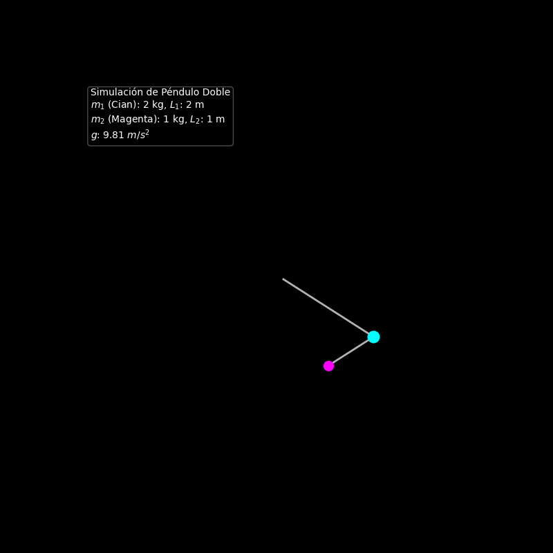

# Computational Methods

**Abstract.** This folder contains a numerical study of the planar double pendulum. The equations of motion are derived from the Lagrangian with SymPy, converted into numerical functions that Numba compiles when it is available, and integrated with SciPy's `odeint` (LSODA). The notebook plots both angles as functions of time and exports an animation of the motion as a GIF. An independent check integrates the explicit equations of motion published in the literature. The total energy is conserved to a relative error of 3 × 10⁻⁶ with the default tolerances, and an energy argument shows that, for the chosen initial conditions, the upper pendulum cannot pass over the top, while the lower one rotates irregularly in both directions. Solutions that differ by 10⁻⁶ rad in the initial angle, or only in the integration tolerance, separate approximately exponentially and differ by 0.1 rad after about 16 s, which sets the predictability horizon of the simulated trajectory.

## Contenido

| Archivo | Descripción |
|---|---|
| [`double_pendulum_simulation.ipynb`](double_pendulum_simulation.ipynb) | Ecuaciones de movimiento con el formalismo de Lagrange, integración numérica, verificación y animación. |
| [`pendulum_animation.gif`](pendulum_animation.gif) | Animación de los primeros 40 s del movimiento, en tiempo real, generada por el notebook. |

## Descripción

El notebook parte de la cinemática del péndulo doble, construye su lagrangiano y obtiene con SymPy las aceleraciones angulares, que se integran con `odeint` para las condiciones iniciales $\theta_1 = 1$ rad, $\theta_2 = -1$ rad, $\dot\theta_1 = -3$ rad/s y $\dot\theta_2 = 5$ rad/s, con $l_1 = 2$ m, $l_2 = 1$ m, $m_1 = 2$ kg y $m_2 = 1$ kg. A partir de los ángulos se calculan las posiciones de las masas, se grafican $\theta_1(t)$ y $\theta_2(t)$ y se genera la animación.

La sección de verificación integra directamente las ecuaciones de movimiento explícitas de Franco García (s.f.), comprueba la conservación de la energía y compara la solución con las tolerancias por defecto con una de alta precisión y con otra de condiciones iniciales perturbadas.

## Resultados principales

- La energía inicial, 41.88 J, es menor que los 49.05 J que necesitaría el péndulo superior para pasar por la vertical superior: $\theta_1$ permanece acotado entre unos $-2.5$ y $2.6$ rad, mientras que el péndulo inferior gira de forma irregular en ambos sentidos.
- La energía se conserva con una desviación relativa de $3\times10^{-6}$ con las tolerancias por defecto de `odeint` y de $1\times10^{-10}$ con tolerancias de $10^{-12}$.
- Una perturbación de $10^{-6}$ rad en $\theta_1(0)$ produce diferencias de 0.1 rad en $\theta_2$ hacia los 17 s, y la solución con las tolerancias por defecto se separa de la de referencia hacia los 16 s. Más allá de ese horizonte, la gráfica y la animación describen el comportamiento cualitativo del sistema y no el movimiento exacto para esas condiciones iniciales.

## Ejecución

Requiere Python 3 con `numpy`, `scipy`, `matplotlib`, `sympy` y `Pillow`. `numba` es opcional: si está instalado, compila las funciones de las aceleraciones y acelera la integración. El notebook se ejecuta en orden desde un kernel limpio y escribe `pendulum_animation.gif` en esta carpeta.
