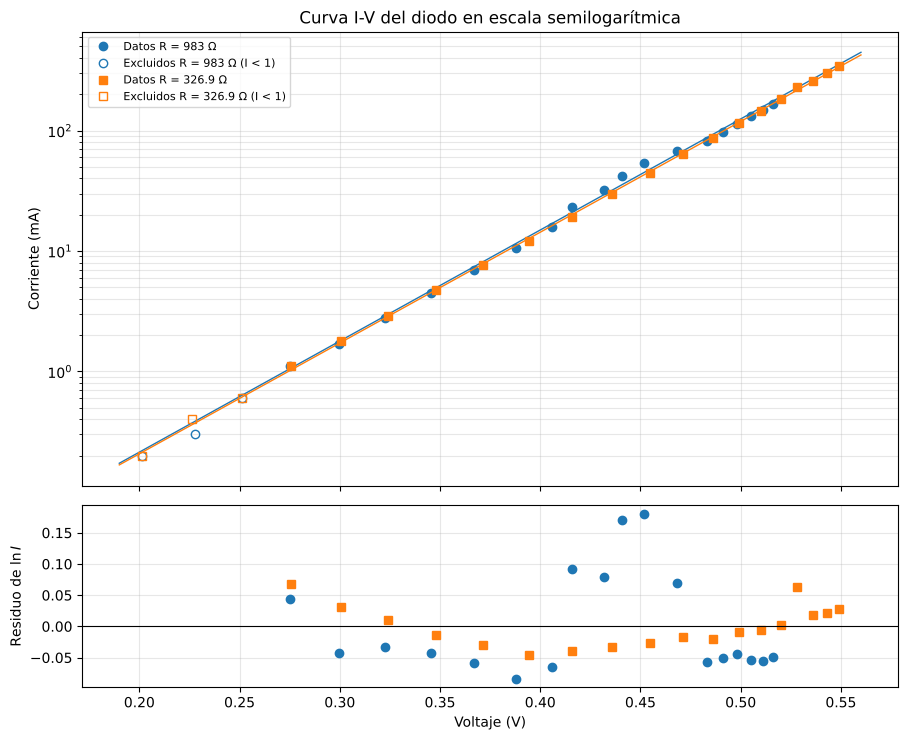
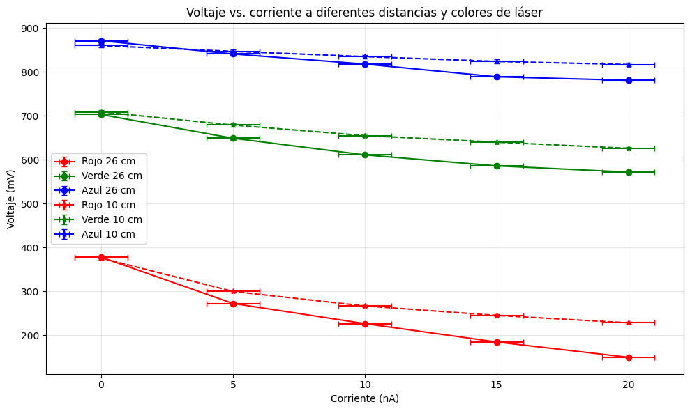
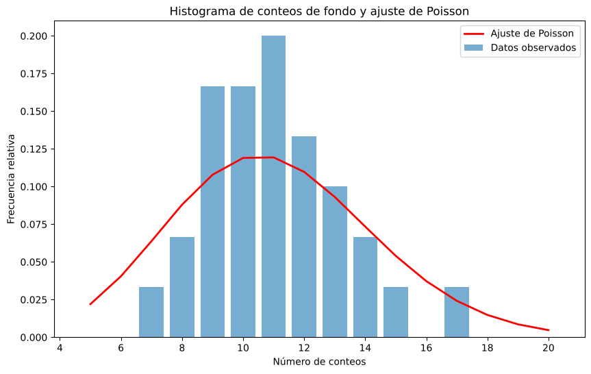
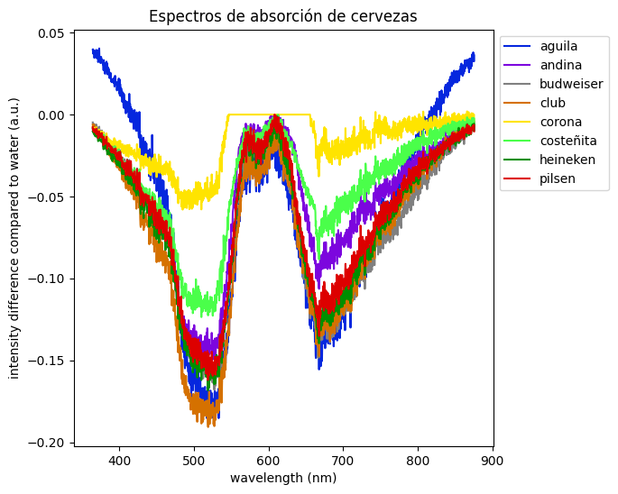

# Experimental Physics IV

**Abstract.** This folder contains four data analyses from the Experimental Physics IV laboratory. Boltzmann's constant is studied through the current-voltage characteristic of a diode: a logarithmic fit gives an ideality factor n = 1.83 when the exact value of k_B is used, and k_B = 1.26 × 10⁻²³ J/K when n = 2 is assumed, which shows that both quantities cannot be separated with measurements at a single temperature. A photoelectric device is characterized for three laser colors and two distances, with uncertainties propagated from the multimeter specifications. Counts from a scintillation detector are tested against the Poisson distribution with chi-square and dispersion tests, and the activity of a sample is assessed against the background; the same notebook solves exercises with the binomial and Poisson distributions. Finally, the light transmitted by eight lager beers is compared with that of water. The analysis shows that detector saturation, not the samples, produces the apparent absorption peaks, and proposes an absorbance measurement at 430 nm, the standard wavelength for beer color.

## Contenido

| Notebook | Tema |
|---|---|
| [`boltzmann_constant_shockley_diode.ipynb`](boltzmann_constant_shockley_diode.ipynb) | Constante de Boltzmann a partir de la ecuación de Shockley del diodo |
| [`photoelectric_effect_voltage_vs_distance_intensity.ipynb`](photoelectric_effect_voltage_vs_distance_intensity.ipynb) | Efecto fotoeléctrico: voltaje en función de la distancia y del color del láser |
| [`poisson_statistics_and_applied_probability_distributions.ipynb`](poisson_statistics_and_applied_probability_distributions.ipynb) | Estadística de Poisson con un tubo escintilador y ejercicios de probabilidad |
| [`lager_beer_absorption_spectrum_analysis.ipynb`](lager_beer_absorption_spectrum_analysis.ipynb) | Espectros de transmisión de cervezas tipo lager frente al agua |

## Constante de Boltzmann y ecuación de Shockley

Se ajusta en escala logarítmica la característica corriente-voltaje de un diodo, medida con dos resistencias en serie distintas.

- Los dos conjuntos de datos describen la misma característica, con $nV_T = 47.2 \pm 0.3$ mV en el ajuste conjunto.
- Con $k_B$ exacta, el factor de idealidad es $n = 1.83 \pm 0.01$. Suponiendo $n = 2$, se obtiene $k_B = (1.26 \pm 0.01)\times10^{-23}$ J/K, un 8.4 % por debajo del valor de CODATA. Separar $n$ y $k_B$ requiere medir la característica a varias temperaturas.
- Para una ley exponencial, el ajuste en escala logarítmica es el adecuado: un ajuste sin pesos en escala lineal queda dominado por los pocos puntos de corriente alta.

## Efecto fotoeléctrico

Se mide el voltaje de un dispositivo fotoeléctrico en función de la corriente ajustada, para láseres rojo, verde y azul situados a 26 cm y a 10 cm, con incertidumbres obtenidas de la especificación del multímetro.

- Para cada corriente y distancia, el voltaje crece con la frecuencia de la luz: la menor diferencia entre colores, 151 mV, es mucho mayor que la mayor incertidumbre individual, 4.9 mV.
- Al acercar el láser, el voltaje aumenta para corrientes distintas de cero, y a 0 nA la diferencia entre distancias es compatible con cero. La intensidad modifica la señal, pero el voltaje máximo lo fija la energía de cada fotón.

## Estadística de Poisson con un tubo escintilador

Se analizan los conteos de radiación de fondo de un tubo escintilador y los obtenidos al acercar una muestra, y se resuelven ejercicios con las distribuciones binomial y de Poisson.

- La forma del histograma de fondo es compatible con una distribución de Poisson de media 11.0 ($\chi^2 = 3.71$ con 2 grados de libertad, valor p de 0.16), pero la varianza muestral, 5.0, es menos de la mitad de la media, algo que bajo la estadística de Poisson tiene una probabilidad de 0.005 y que indica revisar el procedimiento de conteo.
- Cinco conteos altos con la muestra son incompatibles con el fondo. Si se descartan, el exceso de los demás intervalos no es significativo al 95 % de confianza.
- Una prueba $z$ con la desviación estándar de la propia muestra oculta la actividad, porque los mismos conteos altos inflan la desviación estándar; las pruebas sobre datos de conteo deben usar la estadística de Poisson del fondo.

## Espectros de cervezas tipo lager

Se compara la luz transmitida por ocho cervezas tipo lager (Águila, Andina, Budweiser, Club, Corona, Costeñita, Heineken y Pilsen) con la transmitida por el agua.

- El detector se saturó alrededor de 600 nm, y los dos picos de absorción que se identifican a ambos lados de esa región se deben a la saturación y al espectro de la fuente, no a bandas de absorción de las muestras.
- La profundidad de las curvas permite ordenar cualitativamente las cervezas: Corona es la que menos absorbe en el azul y el verde, y Club y Águila las que más.
- El notebook propone medir la absorbancia con un espectro de oscuridad y sin saturación, y compararla a 430 nm con la escala de color de la European Brewery Convention.

Los archivos de datos de este notebook no forman parte del repositorio, por lo que se presenta con las salidas de su ejecución original.

## Ejecución

Requiere Python 3 con `numpy`, `scipy`, `matplotlib` y `pandas`. Los datos de los notebooks del diodo, del efecto fotoeléctrico y de la estadística de Poisson están incluidos en el propio código, de modo que se ejecutan en orden desde un kernel limpio. El de las cervezas necesita los archivos de espectros descritos en su sección de carga de datos.
