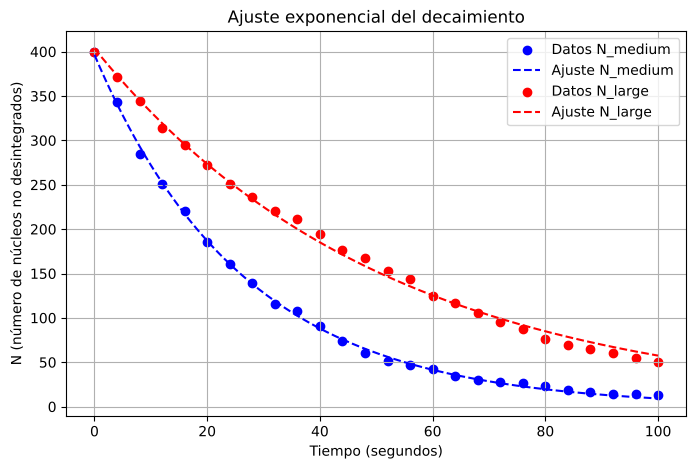
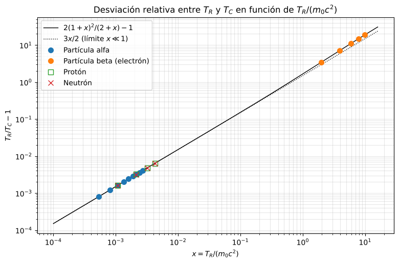
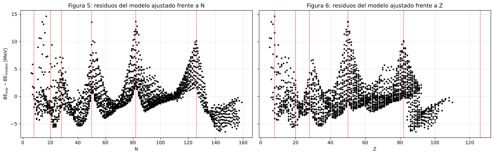
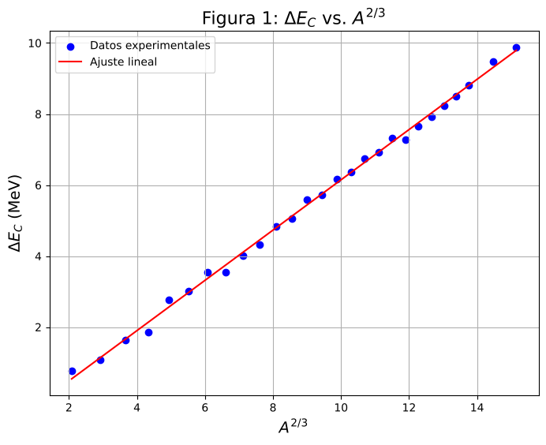

# Introduction to Nuclear Physics

**Abstract.** This folder contains four projects in introductory nuclear physics. The half-lives of two simulated radioactive samples are estimated with exponential and log-linear least-squares fits and with a maximum-likelihood estimator that accounts for the cumulative nature of the counts, and the run-to-run fluctuations of the number of surviving nuclei are compared with the binomial distribution. A relativistic kinematics calculator obtains every kinematic quantity of a particle from any one of them and shows that the ratio between the relativistic and the classical kinetic energy depends only on the kinetic energy in units of the rest energy. The semi-empirical mass formula is fitted to experimental binding energies; its residuals reveal the magic numbers, and a local mass parabola for A = 131 identifies 131Xe as the stable isobar. Finally, the Coulomb displacement energies of 27 pairs of mirror nuclei give a radius parameter r0 between 1.22 and 1.25 fm, depending on the model used to describe the charge distribution.

## Contenido

| Proyecto | Tema |
|---|---|
| [`radioactive_decay_half_life_estimation.ipynb`](radioactive_decay_half_life_estimation.ipynb) | Estimación de la vida media en el decaimiento radiactivo y fluctuaciones binomiales |
| [`relativistic_kinematics_of_particles.ipynb`](relativistic_kinematics_of_particles.ipynb) | Calculadora de cinemática relativista y comparación con la energía cinética clásica |
| [`semi_empirical_mass_formula_a131/`](semi_empirical_mass_formula_a131/) | Fórmula semiempírica de masas y ajuste local para los isóbaros de A = 131 |
| [`mirror_nuclei_coulomb_radius/`](mirror_nuclei_coulomb_radius/) | Radio nuclear a partir de las energías de desplazamiento coulombiano de núcleos espejo |

## Decaimiento radiactivo

Se analizan dos simulaciones de decaimiento con 400 núcleos iniciales cada una. En la primera parte se estima la vida media con tres métodos; en la segunda, se repite la simulación deteniéndola en la vida media y se estudia la dispersión del número de núcleos sobrevivientes.

- El estimador de máxima verosimilitud, que respeta el carácter acumulado de los datos, da $T_{1/2} = 18.5 \pm 0.9$ s y $35.1 \pm 1.9$ s. Las incertidumbres de los ajustes por mínimos cuadrados, de 0.2 a 0.5 s, subestiman la real porque tratan como independientes puntos que no lo son.
- Las fluctuaciones entre ejecuciones son las que predice la distribución binomial, con una dispersión relativa de $1/\sqrt{N_0} = 5\,\%$.
- Los datos de la segunda parte dan una estimación independiente, $17.5 \pm 0.4$ s y $35.5 \pm 0.8$ s, compatible con la primera.

## Cinemática relativista

A partir de una propiedad conocida de una partícula (velocidad, energía total, energía cinética, relación $m/m_0$ o momento) se calculan todas las demás, para el electrón, el protón, el neutrón, el deuterón, la partícula alfa o una partícula definida por el usuario.

- La razón entre la energía cinética relativista y la clásica depende solo de $x = T_R/(m_0c^2)$: $T_R/T_C = 2(1+x)^2/(2+x)$, que para $x \ll 1$ se aproxima a $1 + 3x/2$. Las cuatro partículas estudiadas caen sobre esa curva.
- Para una partícula alfa de 10 MeV la fórmula clásica se equivoca en un 0.4 %; para un electrón de 5 MeV, en un factor cercano a 20.

La calculadora interactiva de la sección 7 pide los datos por teclado con `input()`.

## Fórmula semiempírica de masas

La carpeta [`semi_empirical_mass_formula_a131/`](semi_empirical_mass_formula_a131/) contiene el notebook y el archivo `mybinding.dat`, con el número atómico, el número de masa, la energía de enlace experimental y el número de neutrones de cada núcleo.

- Con los coeficientes ajustados y el término de apareamiento, el residuo cuadrático medio es de 3.0 MeV para $A \geq 16$, y los residuos se concentran en los números mágicos 28, 50, 82 y 126.
- La parábola de masas de los isóbaros de $A = 131$ tiene su mínimo de masa atómica en $Z_\mathrm{A} = 54.30$, en acuerdo con el cero del $Q_\beta$ experimental, $Z_p + 1/2 = 54.24 \pm 0.03$: el isóbaro estable es $^{131}\mathrm{Xe}$. El mínimo de la masa nuclear, en $Z = 54.71$, está desplazado, por lo que la comparación exige usar masas atómicas.
- La parábola reproduce los valores de $Q_\beta$ con diferencias de a lo sumo 0.23 MeV para $Z \geq 50$, y falla junto al cierre de capa de $^{132}\mathrm{Sn}$.

## Núcleos espejo y radio de Coulomb

La carpeta [`mirror_nuclei_coulomb_radius/`](mirror_nuclei_coulomb_radius/) contiene el notebook y el archivo `delta_coulomb.dat`, con las energías de desplazamiento coulombiano de 27 pares de núcleos espejo con $A$ impar entre 3 y 59.

- El ajuste lineal en $A^{2/3}$ describe los datos con un residuo de unos 0.13 MeV y da $r_0 = 1.221 \pm 0.012$ fm, donde la incertidumbre es solo estadística.
- La forma del modelo pesa más que la estadística: los modelos que describen bien los datos dan $r_0$ entre 1.22 y 1.25 fm, en el rango de los radios de carga medidos por dispersión de electrones.
- Los residuos alternan con la paridad del número de protones y cambian bruscamente en los cierres de capa de $^{16}\mathrm{O}$ y $^{40}\mathrm{Ca}$, efectos que una esfera uniformemente cargada no contiene.

## Ejecución

Requiere Python 3 con `numpy`, `scipy`, `matplotlib`, `pandas` y `tabulate`. Cada notebook lee sus datos desde su propia carpeta y se ejecuta en orden desde un kernel limpio.
