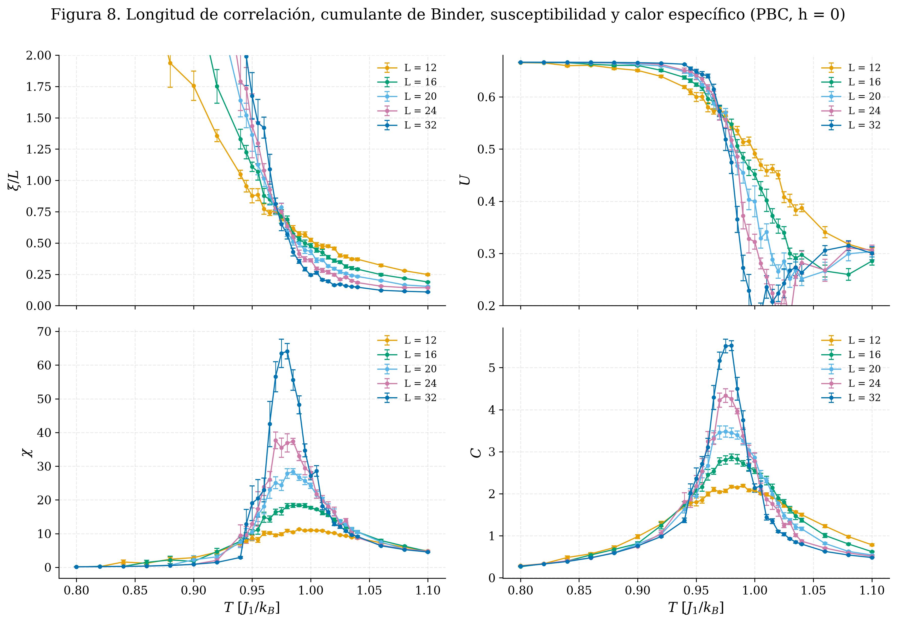
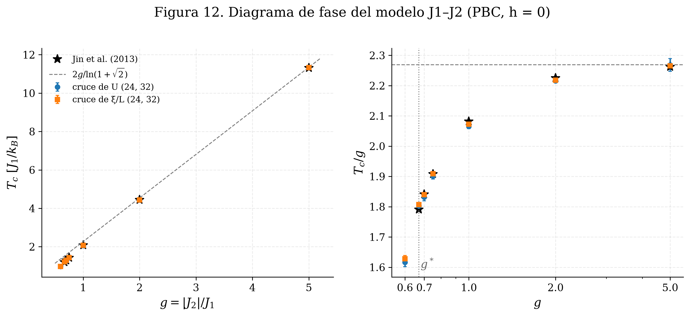
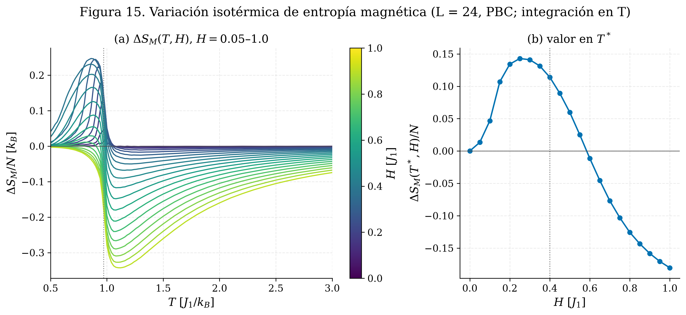
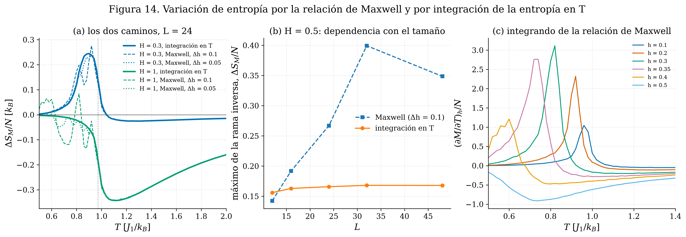

# Modelo de Ising J1–J2 en la red cuadrada: transición stripe y efecto magnetocalórico

**Cristian Camilo Vergara Restrepo** · Instituto de Física, Universidad de Antioquia

## Abstract

We study by Monte Carlo simulation the two-dimensional Ising model on the square lattice with ferromagnetic nearest-neighbour coupling $J_1=1$ and antiferromagnetic next-nearest-neighbour coupling $J_2=-0.6$, a single-plane reduction of the Heisenberg model used by Markna et al. (2026) for Ni-doped GdMnO$_3$. The ordered phase is the fourfold-degenerate stripe state, which the checkerboard sublattice magnetization does not detect. Finite-size scaling of the correlation length, Binder cumulants and response maxima for $L=12$–$64$ locates the transition at $T_c=0.972(1)\,J_1/k_B$. The effective ratio $\alpha/\nu\approx0.94$ rules out the 2D Ising class and, with $1/\nu\approx1.3$–$1.75$, places the transition near the four-state Potts point, with no conclusive first-order signature up to $L=64$. Critical temperatures agree with transfer-matrix results within about 1 % for $0.67\leq|J_2|/J_1\leq5$. Under a uniform field the magnetocaloric effect is inverse below $T_c$, peaking at $0.25\,k_B$ per spin near the critical field $h_c=4|J_2|-2J_1$, and conventional above it, with linear-response field laws.

## Descripción

El proyecto estudia el modelo de Ising bidimensional con acoplamiento ferromagnético a primeros vecinos, $J_1=1$, y antiferromagnético a segundos vecinos, $J_2=-0.6$, en una red cuadrada de $L\times L$ espines:

$$
\mathcal H=-J_1\sum_{\langle i,j\rangle}S_iS_j-J_2\sum_{\langle\langle i,j\rangle\rangle}S_iS_j-h\sum_iS_i .
$$

Es una reducción a un solo plano del modelo de Heisenberg tridimensional que Markna et al. (2026) usan para la manganita GdMn$_{1-x}$Ni$_x$O$_3$. La reducción conserva la competencia entre $J_1$ y $J_2$, que fija el tipo de orden, y permite un estudio sistemático con control de errores; a cambio, el modelo pertenece a otra clase de universalidad, de modo que el objetivo no es reproducir los valores del material sino entender la física de la transición y del efecto magnetocalórico (EMC) en este antiferromagneto frustrado.

El trabajo responde las preguntas de un proyecto de curso (Parte A: curvas termodinámicas para $L=16$ y $24$ con fronteras periódicas y libres; Parte B: temperatura de transición, EMC, poder de enfriamiento relativo, escalado de tamaño finito y clases de universalidad) y las extiende con un análisis de tamaño finito hasta $L=64$, el diagrama de fase $T_c(g)$ frente a la literatura y un estudio detallado del EMC.

## Resultados principales

| resultado | valor |
|---|---|
| fase ordenada ($g=\lvert J_2\rvert/J_1=0.6$) | stripe, degeneración 4 ($\mathbb Z_4$) |
| temperatura crítica, $L=24$–$64$ | $T_c=0.9718\pm0.0010$ (cruces de $\xi/L$), $0.9709\pm0.0008$ (cruces de $U$), en $J_1/k_B$ |
| cocientes de exponentes efectivos | $\gamma/\nu=1.74\pm0.05$, $\beta/\nu=0.13\pm0.02$, $\alpha/\nu=0.94\pm0.04$, $1/\nu$ entre $1.3$ y $1.75$ según el estimador |
| orden de la transición | sin señales concluyentes de primer orden hasta $L=64$ |
| $T_c(g)$ frente a matriz de transferencia (Jin et al., 2013) | desviaciones entre $-0.8$ % y $+0.9$ % para $0.67\leq g\leq5$ |
| EMC inverso ($T<T_c$) | máximo $\Delta S_M/N=0.247\,k_B$ con $H=0.35$, por debajo de $h_c=0.4$ |
| EMC convencional ($T>T_c$) | respuesta lineal: $n=2.16\pm0.03$, $p=2.00\pm0.03$, $m=1.82\pm0.06$ |
| cambio de signo de $\Delta S_M(T_c,H)$ | $H=0.584\pm0.004$ |

Los errores son estadísticos (bootstrap entre réplicas independientes). Las cifras completas están en las Tablas 11, 17, 20, 21 y 31 del notebook y en la carpeta `results/`.

**Transición de fase.** Las curvas de $\xi/L$ y del cumulante de Binder de distintos tamaños se cruzan en la temperatura crítica, y las alturas de los máximos de $\chi$ y $C$ crecen como potencias de $L$.



**Validación con la literatura.** La temperatura crítica en función de $g$ reproduce los valores de matriz de transferencia y tiende al límite de dos redes de Ising desacopladas.



**Efecto magnetocalórico.** $\Delta S_M(T,H)$ tiene una rama inversa por debajo de $T_c$, donde el campo uniforme compite con el orden stripe, y una convencional por encima; ninguna tiene su extremo en $T_c$.



**Método.** En la fase ordenada, la relación de Maxwell integrada sobre una malla discreta de campos produce estructuras que dependen de la malla y crecen con $L$; la integración de la entropía en temperatura a campo fijo las elimina y da amplitudes que convergen con el tamaño.



## Metodología

- **Monte Carlo.** Algoritmo de Metrópolis de un espín con tabla de aceptación precalculada y actualización incremental de la energía y de los parámetros de orden; barridos térmicos con memoria (enfriamiento desde una configuración aleatoria y, como control, calentamiento desde el estado fundamental). Núcleos compilados con Numba.
- **Réplicas y semillas.** Cada punto combina entre 4 y 10 réplicas independientes, con semillas derivadas de una semilla base mediante `numpy.random.SeedSequence`; las réplicas se ejecutan en paralelo en procesos separados y cada una es reproducible por sí misma.
- **Estimadores.** Calor específico y susceptibilidades con la varianza de la serie completa de cada réplica (el promedio de varianzas por bloques cortos está sesgado a la baja cerca de $T_c$); errores jackknife y bootstrap entre réplicas; tiempo de autocorrelación con ventana automática.
- **Transición.** Cruces de la longitud de correlación de segundo momento $\xi/L$ y del cumulante de Binder, alturas de los máximos de $\chi$ y $C$, colapso de datos y cumulante de la energía, con dos conjuntos de tamaños ($L=12$–$32$ y $24$–$64$).
- **EMC.** $\partial M/\partial T$ por la identidad de fluctuación $\mathrm{Cov}(M,E)/T^2$; $\Delta S_M(T,H)$ por integración de la entropía en temperatura a campo fijo, con la relación de Maxwell como referencia en la fase paramagnética; $\Delta T_{ad}$ sin linealizar y RCP.
- **Validación.** Energía incremental frente a recálculo directo, enumeración exacta de una red $4\times4$, factor de estructura frente a la FFT, termodinámica exacta del EMC en $4\times4$ (pruebas en `tests/`) y temperaturas críticas frente a la matriz de transferencia de Jin et al. (2013).

## Estructura del repositorio

```text
antiferromagnetic_ising2d_magnetocaloric_effect/
├── antiferromagnetic_ising2d_magnetocaloric_effect.ipynb   documento principal
├── isingj1j2/                 paquete con el código numérico
│   ├── kernels.py             Metrópolis y muestreo (Numba)
│   ├── simulation.py          tareas, semillas, ejecución en paralelo y caché
│   ├── lattice.py             red, configuraciones de referencia, enumeración exacta
│   ├── estimators.py          momentos, jackknife, bootstrap, autocorrelación
│   ├── fss.py                 escalado de tamaño finito
│   ├── mce.py                 efecto magnetocalórico
│   ├── plotting.py, report.py estilo de figuras y tablas
│   └── config.py              constantes, rutas y opciones
├── tests/                     pruebas (pytest)
├── figures/                   figuras del notebook (PNG y PDF) y animaciones GIF
├── results/                   tablas del notebook en CSV
├── requirements.txt
└── README.md
```

La carpeta `data/`, con los resultados crudos de las simulaciones, no se incluye en el repositorio: se genera al ejecutar el notebook.

## Instalación y ejecución

Requiere Python 3.10 o posterior. Desde la carpeta del proyecto:

```bash
python -m pip install -r requirements.txt
python -m pytest -q tests
python -m jupyter nbconvert --to notebook --execute --inplace --ExecutePreprocessor.timeout=-1 antiferromagnetic_ising2d_magnetocaloric_effect.ipynb
```

También puede ejecutarse desde Jupyter o VS Code con *Run All*; el notebook debe abrirse desde su carpeta, porque importa el paquete `isingj1j2` que está junto a él.

**Costo.** Todas las simulaciones suman unos $5\times10^{11}$ intentos de volteo; en una máquina con 24 hilos de ejecución, el notebook completo tarda entre 25 y 30 minutos. Al comenzar, el notebook mide la velocidad del núcleo en la máquina y, antes de cada bloque de simulaciones, imprime su costo estimado. Cada simulación se guarda en `data/` y, si sus parámetros no cambian, se recarga en lugar de repetirse, de modo que una segunda ejecución solo rehace el análisis.

**Opciones.** Variables de entorno, definidas antes de abrir Jupyter o de llamar a `nbconvert`:

| variable | efecto |
|---|---|
| `ISINGJ1J2_WORKERS` | número de procesos (por defecto, todos los núcleos lógicos) |
| `ISINGJ1J2_EXECUTOR` | `process` (por defecto), `thread` o `serial` |
| `ISINGJ1J2_SCALE` | factor de escala de los pasos Monte Carlo; por ejemplo `0.02` ejecuta el notebook completo en pocos minutos para comprobar la instalación (resultados sin valor físico, guardados en carpetas aparte) |

En PowerShell, por ejemplo: `$env:ISINGJ1J2_WORKERS = "12"`.

**Reproducibilidad.** Cada réplica tiene su propia semilla, derivada de la semilla base y de los índices de la tarea; la misma semilla fija la configuración inicial y la dinámica de Metrópolis. Con la misma versión de Numba, una réplica da el mismo resultado sin importar el proceso en que se ejecute. Dos ejecuciones completas e independientes del notebook, con 24 procesos en paralelo, dieron tablas idénticas cifra por cifra.

## Limitaciones

- El modelo es bidimensional, de espines de Ising y sin acoplamiento entre planos ni anisotropía: sirve para estudiar la física de la frustración $J_1$–$J_2$ y la estructura del EMC en un antiferromagneto stripe, no para predecir valores del material.
- Los exponentes son efectivos para $L\leq64$ y sus errores son solo estadísticos; cerca del punto de Potts de 4 estados las correcciones al escalado son logarítmicas. $1/\nu$ tiene errores de 0.2 a 0.25 y por sí solo no discrimina entre clases.
- El orden de la transición en $g=0.6$ no queda decidido: una transición de primer orden extremadamente débil solo se manifestaría con tamaños mucho mayores, inaccesibles con el Metrópolis local, cuyo tiempo de autocorrelación en la transición crece como $L^{z}$ con $z\approx2$.
- Con fronteras libres solo se usaron tamaños hasta $L=32$: los cruces de $\xi/L$ y de $U$ quedan todavía un 2 % por debajo de la $T_c$ de PBC, y las extrapolaciones lineales en $1/L$ no son fiables con esos tamaños.

## Referencias principales

- Jin, S., Sen, A., Guo, W., & Sandvik, A. W. (2013). Phase transitions in the frustrated Ising model on the square lattice. *Physical Review B, 87*, 144406. https://doi.org/10.1103/PhysRevB.87.144406
- Li, S.-W., & Jiang, F.-J. (2024). A comprehensive study of the phase transitions of the frustrated $J_1$–$J_2$ Ising model on the square lattice. *Progress of Theoretical and Experimental Physics, 2024*(5), 053A06. https://doi.org/10.1093/ptep/ptae061
- Franco, V., Blázquez, J. S., Ipus, J. J., Law, J. Y., Moreno-Ramírez, L. M., & Conde, A. (2018). Magnetocaloric effect: From materials research to refrigeration devices. *Progress in Materials Science, 93*, 112–232. https://doi.org/10.1016/j.pmatsci.2017.10.005
- Pecharsky, V. K., Gschneidner, K. A., Jr., Pecharsky, A. O., & Tishin, A. M. (2001). Thermodynamics of the magnetocaloric effect. *Physical Review B, 64*, 144406. https://doi.org/10.1103/PhysRevB.64.144406
- Landau, D. P., & Binder, K. (2021). *A guide to Monte Carlo simulations in statistical physics* (5th ed.). Cambridge University Press. https://doi.org/10.1017/9781108780346
- Markna, J. H., Dudharejiya, T., Katariya, D., Dhruv, D. K., & Kataria, B. (2026). *Monte Carlo investigation of magnetocaloric properties and critical behavior in Ni-doped GdMnO$_3$ perovskites: A comparative study with experimental data* [Manuscrito enviado para publicación]. Journal of Magnetism and Magnetic Materials.

La bibliografía completa está en la Sección 14 del notebook.
