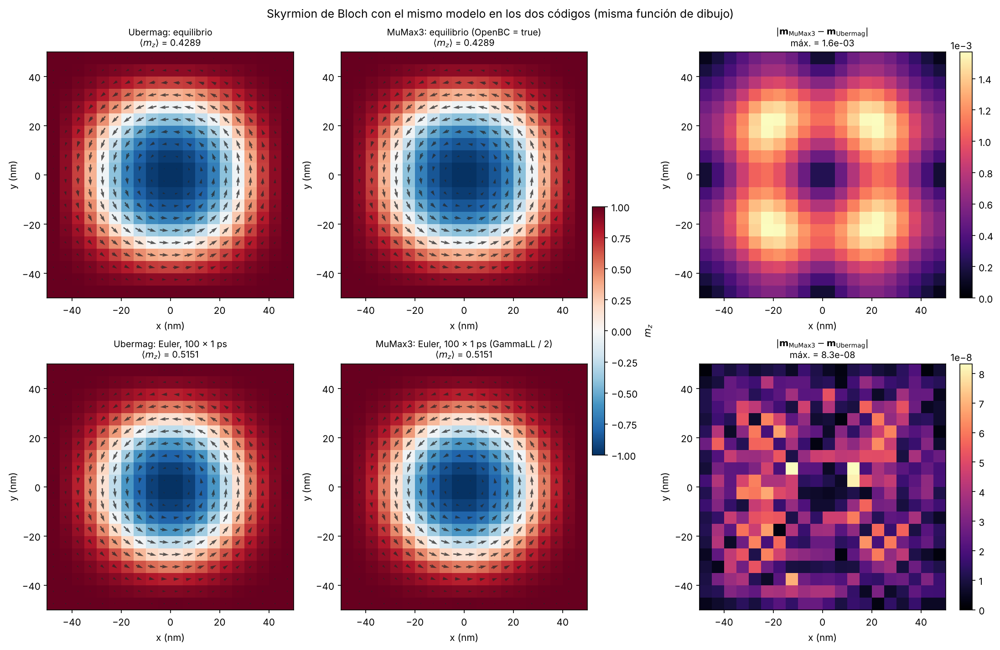
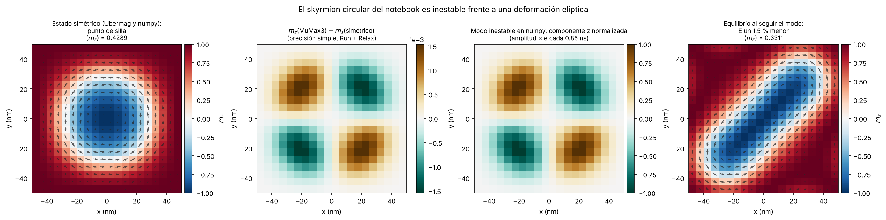
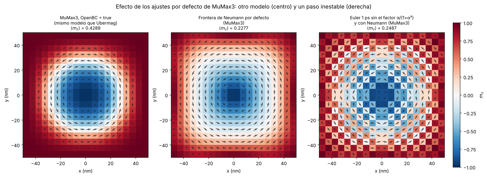
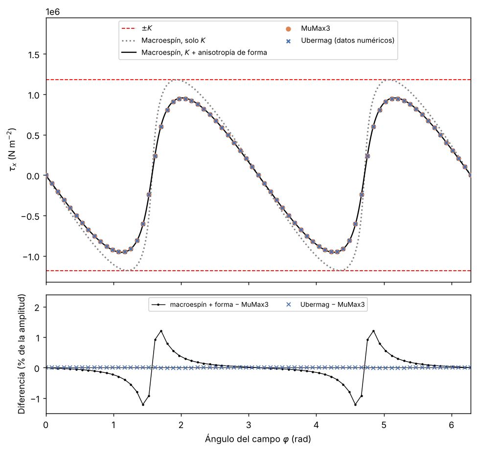
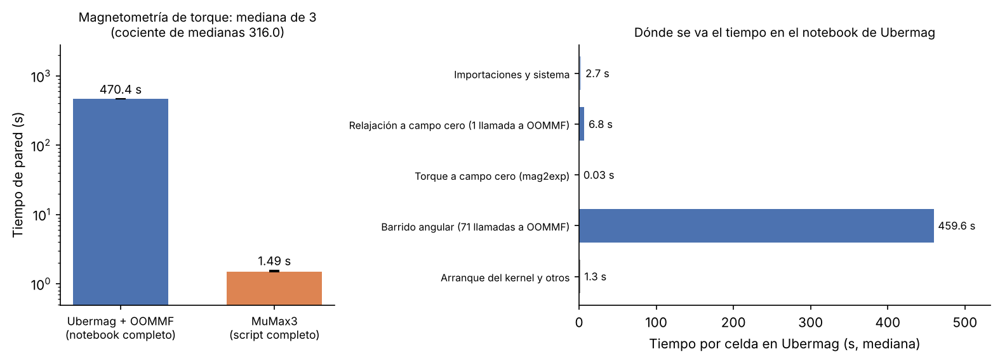
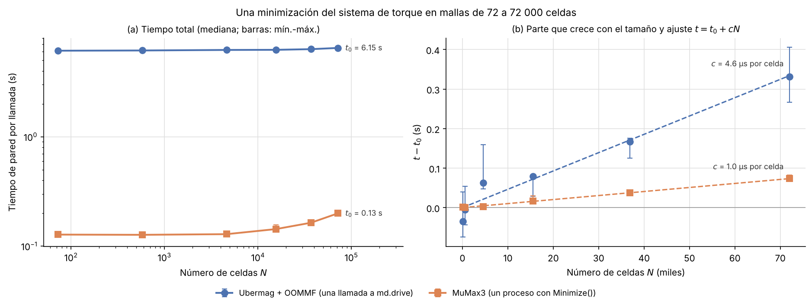

# Ubermag frente a MuMax3: energía de un skyrmion y magnetometría de torque

**Cristian Camilo Vergara Restrepo** · Instituto de Física, Universidad de Antioquia

## Abstract

Two examples from the Ubermag documentation, *Field operations 2* (energy terms of a Bloch skyrmion) and *Torque magnetometry* (torque sweep of a box with uniaxial anisotropy), are explained for an undergraduate magnetism course with their original computations and reimplemented in MuMax3. Configured with the same model, MuMax3 reproduces Ubermag/OOMMF: the skyrmion energy terms agree within $1.2\times10^{-6}$, explicit Euler states within $10^{-7}$ and torque curves within $4\times10^{-5}$ of their amplitude. Agreement requires open boundaries for the DMI and a halved gyromagnetic ratio when precession is disabled. The remaining difference between relaxed skyrmions is physical: the circular skyrmion is a saddle point, unstable against an elliptical deformation that lowers the energy by 1.5 %, and single-precision rounding in MuMax3 seeds that mode. The torque amplitude is the effective anisotropy of the box, reproduced within 1.2 % by a macrospin with analytical demagnetizing factors. A fixed cost of 6.15 s per OOMMF call explains most of the 26- and 316-fold wall-clock ratios.

## Descripción

El proyecto toma dos ejemplos de la documentación de Ubermag y los presenta para un curso de Fundamentos en Magnetismo:

- **[Field operations 2](https://ubermag.github.io/examples/notebooks/field-operations2.html)**: un skyrmion de Bloch en una película de FeGe de $100\times100\times5$ nm con intercambio, interacción de Dzyaloshinskii-Moriya, anisotropía uniaxial y campo Zeeman. Se calcula la energía y el campo efectivo de cada término y se integra la relajación con un Euler explícito.
- **[Torque magnetometry](https://ubermag.github.io/documentation/notebooks/mag2exp/Torque_magnetometry.html)**: una caja de $300\times300\times100$ nm con anisotropía uniaxial y campo desmagnetizante, sometida a un campo que rota en el plano $yz$; `mag2exp` mide el torque por unidad de volumen en 71 ángulos.

Las operaciones de cálculo de las celdas de código son las de los ejemplos; las celdas añaden comentarios y cambian la presentación de los resultados (la sección 1 de cada notebook detalla qué cambia). Lo añadido está en las celdas de Markdown: los fundamentos físicos de cada término, la explicación de cada bloque de código, el análisis de los resultados y una sección 8 que repite cada problema en MuMax3 y compara los resultados y los tiempos de ejecución de las dos herramientas.

## Resultados principales

| Comparación | Resultado |
|---|---|
| Energías del skyrmion (Zeeman, anisotropía, intercambio, DMI) | MuMax3 coincide con Ubermag con diferencias relativas de $1.2\times10^{-6}$ o menos; $\langle m_z\rangle=0.42886$ en ambos |
| Euler explícito de 100 pasos de 1 ps | diferencia máxima de $8.3\times10^{-8}$ por celda con la misma $\gamma_0$, el nivel de la precisión simple |
| Estado relajado del skyrmion | diferencia máxima de $1.6\times10^{-3}$, entera a lo largo de un modo inestable: el skyrmion circular es un punto de silla, y el skyrmion alargado al que lleva ese modo tiene una energía 1.5 % menor |
| Frontera del DMI por defecto en MuMax3 (Neumann) | otro modelo: añade $-D^2/2A\,(m_x^2+m_y^2)$, y MuMax3 relaja a $\langle m_z\rangle=0.2277$, como la réplica en `numpy` ($1.6\times10^{-6}$ por celda) |
| Curva de torque | coincide en los 71 ángulos con una diferencia máxima de $3.9\times10^{-5}$ de la amplitud; la amplitud, $9.487\times10^{5}$ N m$^{-2}$, es $K_\mathrm{eff}$ y no $K=1.18\times10^{6}$ J m$^{-3}$ |
| Tiempo de pared (mediana de 3) | skyrmion: 89.8 s frente a 3.48 s; torque: 470.4 s frente a 1.49 s |
| Costo de una minimización frente al número de celdas $N$ | Ubermag: $6.15$ s fijos más 4.6 µs por celda; MuMax3, proceso completo: $0.126$ s más 1.0 µs por celda |

Los tiempos describen el flujo de trabajo en un equipo concreto: cada llamada de Ubermag lanza un proceso de OOMMF con un costo fijo de 6.15 s, y con la malla de 72 000 celdas el cálculo añade solo unos 0.33 s, mientras que MuMax3 resuelve todo en un único proceso en la GPU. No son una medida de la velocidad de los solvers.

**Estados del skyrmion.** Los dos códigos dibujados con la misma función, junto con la diferencia celda a celda.



**Estabilidad del skyrmion circular.** La diferencia entre el estado de MuMax3 y el simétrico coincide con el modo inestable que se obtiene en `numpy`; siguiendo ese modo, el skyrmion se alarga en una diagonal de la caja.



**Ajustes por defecto de MuMax3.** La frontera de Neumann del DMI cambia el equilibrio, y sin el factor $\alpha/(1+\alpha^2)$ el mismo paso de Euler se vuelve inestable.



**Torque.** La curva de MuMax3, la de Ubermag y el macroespín con anisotropía de forma.



**Tiempos de ejecución.** El notebook de torque frente al script de MuMax3, y una sola minimización en mallas de 72 a 72 000 celdas.





## Metodología

- **Fidelidad a los ejemplos.** Las operaciones de cálculo son las de los ejemplos de Ubermag, comparadas línea a línea con `examples/field-operations2.ipynb` de `ubermag/tutorials` y con `docs/Torque_magnetometry.ipynb` de `mag2exp` 0.64.0. El análisis y la comparación con MuMax3 están en Markdown y en scripts aparte.
- **Implementación en MuMax3.** Misma malla, mismos parámetros y mismo procedimiento. En el skyrmion, `OpenBC = true` y `GammaLL` a la mitad, calculada con la $\gamma_0$ del notebook, para resolver el mismo modelo y el mismo esquema de Euler; la relajación usa `Run(5e-9)` y `Relax()` e imprime `MaxTorque` tras cada etapa. La sección 8 de cada notebook documenta las diferencias de convención (unidades del campo, constante de la anisotropía, energía de DMI incluida en `E_exch`, minimizadores y criterios de parada).
- **Validación independiente.** Una réplica en `numpy` de doble precisión de los operadores del notebook del skyrmion, comparada con las referencias de Ubermag, con su estado guardado y con las salidas de MuMax3. Para el torque, un modelo de macroespín de Stoner-Wohlfarth con los factores desmagnetizantes analíticos de Aharoni (1998).
- **Comparación de estados.** Los estados de los dos códigos se dibujan con la misma función y se comparan celda a celda, después de comprobar el par residual de cada uno.
- **Estabilidad.** Perturbaciones aleatorias de $10^{-9}$ del estado relajado, integradas con el torque de amortiguamiento del notebook, distinguen un mínimo de un punto de silla; la diferencia entre los dos códigos se proyecta sobre el modo inestable.
- **Tiempos.** Cada notebook se ejecuta completo con `nbclient` sobre una copia, y cada script de MuMax3 con `mumax3 -f` tras una ejecución de calentamiento; se reporta la mediana, el mínimo y el máximo de 3 repeticiones y el tiempo de cada celda del notebook. Un segundo benchmark mide una sola minimización del sistema de torque en mallas de 72 a 72 000 celdas y ajusta $t=t_0+cN$, para separar el costo fijo de cada llamada del costo que crece con el tamaño.
- **Pruebas.** `tests/` comprueba con `pytest` la lectura de archivos OVF, la réplica en `numpy`, la inestabilidad del skyrmion circular, los factores desmagnetizantes, el macroespín, la coincidencia numérica con las salidas incluidas de los dos códigos y la generación de las figuras y tablas, sin GPU ni Ubermag.

## Estructura del repositorio

```text
ubermag_vs_mumax3/
├── micromagnetic_energy_terms_skyrmion.ipynb   ejemplo Field operations 2
├── torque_magnetometry_uniaxial_box.ipynb      ejemplo Torque magnetometry
├── mumax3/
│   ├── skyrmion_energy_terms_mumax3.mx3        el skyrmion en MuMax3, con el mismo modelo que OOMMF
│   ├── skyrmion_default_settings_mumax3.mx3    el skyrmion con la frontera del DMI y GammaLL por defecto
│   ├── torque_magnetometry_mumax3.mx3          el barrido de torque en MuMax3
│   └── *.out/                                  salidas de MuMax3 (OVF, energías, log, torque)
├── scripts/
│   ├── validate_skyrmion_numpy.py              réplica en numpy y comparación con los dos códigos
│   ├── skyrmion_instability_numpy.py           estabilidad del skyrmion circular y modo inestable
│   ├── plot_skyrmion_states.py                 figuras de estados del skyrmion
│   ├── validate_torque_macrospin.py            macroespín, factores desmagnetizantes y figura de torque
│   ├── plot_torque_mumax3.py                   gráfica rápida de la salida de torque de MuMax3
│   ├── ovf_io.py                               lectura y escritura de archivos OVF 2.0
│   ├── benchmark_ubermag_vs_mumax3.py          tiempos de los notebooks y de los scripts
│   ├── make_benchmark_figure.py                figuras de tiempos
│   └── benchmark_scaling.py                    tiempo de una minimización frente al número de celdas
├── tests/                                      pruebas con pytest
├── figures/                                    figuras de la sección 8 (también embebidas en los notebooks)
├── results/                                    datos numéricos de Ubermag y tablas de tiempos
├── licenses/                                   avisos de licencia de los ejemplos de Ubermag
├── environment.yml
├── requirements.txt
└── README.md
```

## Instalación y ejecución

Los notebooks necesitan Ubermag, que con `conda` instala también OOMMF (Ubermag developers, s. f.); los scripts `.mx3` necesitan MuMax3 y una GPU NVIDIA.

```bash
conda env create -f environment.yml
conda activate ubermag_env
```

`environment.yml` fija las versiones de `discretisedfield`, `micromagneticmodel`, `oommfc` y `mag2exp` con las que se ejecutaron los notebooks. Sin conda, los scripts de `scripts/` y las pruebas solo necesitan `python -m pip install -r requirements.txt`.

MuMax3 se instala aparte, desde su página oficial, y su ejecutable `mumax3` debe estar en el `PATH`. Desde la carpeta del proyecto:

```bash
cd mumax3
mumax3 -f skyrmion_energy_terms_mumax3.mx3
mumax3 -f skyrmion_default_settings_mumax3.mx3
mumax3 -f torque_magnetometry_mumax3.mx3
cd ..

python scripts/validate_skyrmion_numpy.py
python scripts/skyrmion_instability_numpy.py
python scripts/plot_skyrmion_states.py
python scripts/plot_torque_mumax3.py
python scripts/validate_torque_macrospin.py

python scripts/benchmark_ubermag_vs_mumax3.py --repeats 3
python scripts/make_benchmark_figure.py
python scripts/benchmark_scaling.py --repeats 3

python -m pytest tests
```

Cada script lee sus datos de `mumax3/` y `results/` y escribe sus figuras en `figures/`, sin importar desde qué carpeta se ejecute. Los scripts de validación y de figuras funcionan sin GPU con las salidas de MuMax3 y los datos de Ubermag incluidos. El benchmark de los notebooks tarda unos 30 minutos en el equipo de la tabla, casi todo en el notebook de torque con Ubermag, y el de tamaño, unos 3 minutos; con `--skip-ubermag` o `--skip-mumax3`, cada uno repite solo una parte y conserva las filas ya medidas de la otra.

Para guardar los datos numéricos de Ubermag en `results/`, que usan los scripts de validación, se ejecuta una pasada aparte; esa pasada no modifica las tablas de tiempos:

```bash
python scripts/benchmark_ubermag_vs_mumax3.py --skip-mumax3 --repeats 1 --dump-arrays
```

## Estado de la validación

Ejecutado el 31 de octubre de 2026 en un equipo con Windows 11, Intel Core i7-14650HX y GPU NVIDIA RTX 5060 Laptop, con Python 3.12.14, `discretisedfield` 0.92.0, `micromagneticmodel` 0.65.0, `oommfc` 0.66.0, `mag2exp` 0.64.0 y MuMax3 3.12: los dos notebooks, los tres scripts de MuMax3, los dos benchmarks con 3 repeticiones, la pasada con `--dump-arrays` y las pruebas de `tests/`. Comprobado con `numpy`, con los datos numéricos de Ubermag y con el código fuente de `oommfc`: las energías y el estado del skyrmion, su inestabilidad elíptica, el Euler explícito, el término de frontera de Neumann, el factor del torque sin precesión, la razón giromagnética, los valores por defecto de `MinDriver` y la curva de torque con anisotropía de forma.

## Limitaciones

- La comparación de tiempos corresponde a un equipo y a una instalación. El costo fijo de 6.15 s por llamada a OOMMF puede ser distinto en otros equipos y sistemas operativos (en Windows incluye un proceso adicional de `killoommf` por llamada).
- El tiempo de una sola minimización de MuMax3 no se pudo aislar como diferencia de dos procesos: queda por debajo de la dispersión entre procesos, unos 0.02 s. La cifra de 0.018 s por ángulo es una estimación a partir del barrido completo.
- OOMMF trabaja en CPU con doble precisión y MuMax3 en GPU con precisión simple; los dos minimizan con algoritmos y criterios de parada distintos: `MinDriver` usa gradiente conjugado y `stopping_mxHxm` $=0.1$ A/m (valores por defecto de `oommfc` 0.66.0), y `Minimize()` de MuMax3, un criterio sobre el cambio de $\mathbf m$ entre iteraciones.
- La inestabilidad elíptica del skyrmion circular se estableció con la réplica en `numpy` y con el estado relajado de MuMax3. No se relajó un estado perturbado en OOMMF ni en MuMax3 hasta el skyrmion alargado.
- En el skyrmion, `Minimize()` de MuMax3 se detuvo lejos del equilibrio en una prueba y no se determinó por qué; el script relaja con dinámica amortiguada y `Relax()`, y comprueba `MaxTorque`.
- La diferencia de 1.2 % entre la simulación de torque y el macroespín con anisotropía de forma es compatible con la magnetización no uniforme cerca de las caras de la caja y con la discretización, pero no se separó cada contribución.
- Ubermag también puede usar MuMax3 como calculador (`mumax3c`, incluido en el metapaquete `ubermag`). Aquí no se usó: los scripts `.mx3` están escritos a mano para controlar cada ajuste de MuMax3.

## Origen y licencia de los ejemplos

Los notebooks derivan de dos ejemplos de Ubermag distribuidos con licencia BSD de 3 cláusulas: `examples/field-operations2.ipynb` del repositorio [ubermag/tutorials](https://github.com/ubermag/tutorials) (copyright 2022, Marijan Beg y Hans Fangohr) y `docs/Torque_magnetometry.ipynb` del repositorio [ubermag/mag2exp](https://github.com/ubermag/mag2exp) (copyright 2024, sus colaboradores). Los avisos de copyright y las condiciones de las dos licencias están en `licenses/`.

## Referencias principales

- Ubermag developers. (s. f.). *Field operations 2* y *Torque magnetometry*. Ubermag documentation. https://ubermag.github.io/
- Beg, M., Lang, M., & Fangohr, H. (2022). Ubermag: Toward more effective micromagnetic workflows. *IEEE Transactions on Magnetics, 58*(2), 1-5. https://doi.org/10.1109/TMAG.2021.3078896
- Donahue, M. J., & Porter, D. G. (1999). *OOMMF user's guide, version 1.0* (NISTIR 6376). National Institute of Standards and Technology. https://doi.org/10.6028/NIST.IR.6376
- Vansteenkiste, A., Leliaert, J., Dvornik, M., Helsen, M., Garcia-Sanchez, F., & Van Waeyenberge, B. (2014). The design and verification of MuMax3. *AIP Advances, 4*(10), 107133. https://doi.org/10.1063/1.4899186
- Holt, S. J. R., Lang, M., Loudon, J. C., Hicken, T. J., Suess, D., Cortés-Ortuño, D., Pathak, S. A., Beg, M., Zulfiqar, K., & Fangohr, H. (2025). Virtual experiments in computational magnetism with mag2exp. *npj Computational Materials, 11*, 201. https://doi.org/10.1038/s41524-025-01686-3
- Aharoni, A. (1998). Demagnetizing factors for rectangular ferromagnetic prisms. *Journal of Applied Physics, 83*(6), 3432-3434. https://doi.org/10.1063/1.367113
- Leonov, A. O., Monchesky, T. L., Romming, N., Kubetzka, A., Bogdanov, A. N., & Wiesendanger, R. (2016). The properties of isolated chiral skyrmions in thin magnetic films. *New Journal of Physics, 18*(6), 065003. https://doi.org/10.1088/1367-2630/18/6/065003

La bibliografía completa está en la sección de referencias de cada notebook.
