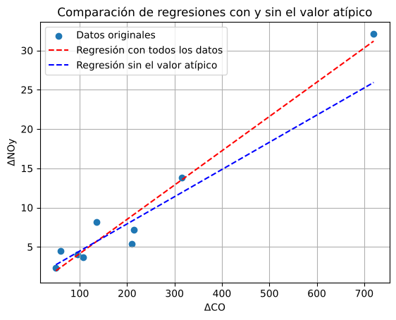

# Probability and Statistics

**Abstract.** This folder contains a set of solved exercises in statistical inference and simple linear regression, based on a written exam whose handwritten statements are included as a PDF. The notebook builds confidence intervals for the mean with known and unknown variance, tests hypotheses about the mean with the t distribution and reports p-values, and computes the sample size needed to reach a prescribed power, comparing the usual normal approximation with the exact calculation based on the noncentral t distribution, which raises the required size from 24 to 26 observations. In the regression problems it fits least-squares lines, computes correlation and determination coefficients, residuals and a 95% prediction interval, and evaluates the influence of an extreme observation through its leverage and Cook's distance. The last analysis shows that a single point controls most of the fitted slope and the forecast in a region without data. Several exercises are adapted from Devore's textbook.

## Contenido

| Archivo | Descripción |
|---|---|
| [`statistical_inference_and_regression_analysis.ipynb`](statistical_inference_and_regression_analysis.ipynb) | Solución de los seis ejercicios del parcial |
| [`Parcial_6_escrito.pdf`](Parcial_6_escrito.pdf) | Enunciados originales, escritos a mano |

## Ejercicios

| Punto | Tema | Resultado principal |
|---|---|---|
| 1.A | Límite elástico de varillas: estadística descriptiva e intervalos de confianza con $\sigma$ conocida | Intervalos del 90 % y del 92 % para la media; curtosis compatible con una distribución normal |
| 1.B | Grado de polimerización: diagrama de caja e intervalo con la distribución $t$ | Intervalo del 95 % de (405.4, 413.8); un promedio de 440 no es plausible |
| 2.A | Materia orgánica en el suelo: prueba $t$ bilateral | Valor p de 0.089: se rechaza $\mu = 3\,\%$ al 10 %, pero no al 5 % |
| 2.B | Detectores de mercurio: prueba $t$ y tamaño de muestra | No se rechaza $\mu = 1$ mg (valor p de 0.38); se requieren 24 observaciones con la aproximación normal y 26 con la $t$ no central |
| 3.A | Altura y precio de locales: correlación y recta de mínimos cuadrados | $r = 0.94$; la recta explica el 88.8 % de la variación del precio |
| 3.B | $\Delta$CO y $\Delta$NOy: regresión, intervalo de predicción e influencia | La observación con $\Delta$CO = 720 tiene palanca 0.85 y distancia de Cook 3.96; sin ella, el pronóstico para $\Delta$CO = 400 baja de 17.2 a 14.8 |

## Ejecución

Requiere Python 3 con `numpy`, `scipy`, `pandas`, `scikit-learn` y `matplotlib`. Los datos están incluidos en el código, de modo que el notebook se ejecuta en orden desde un kernel limpio.
