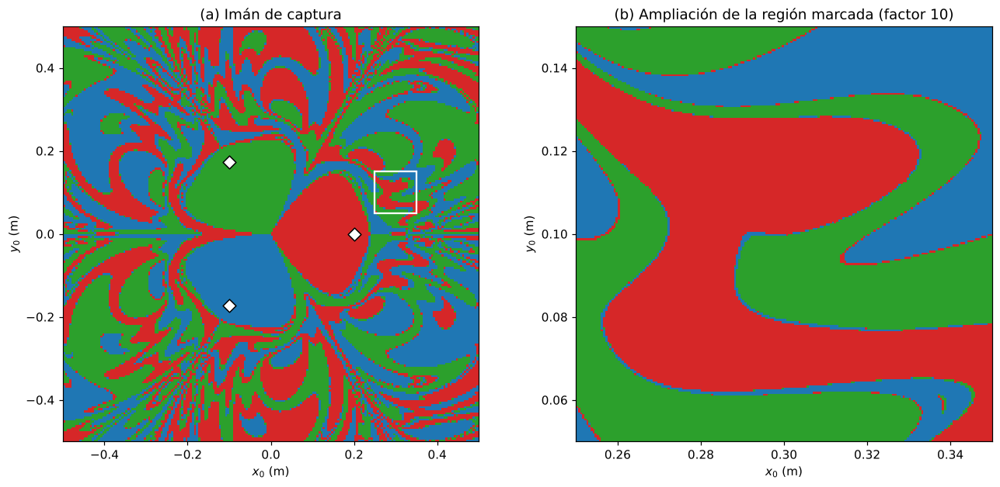
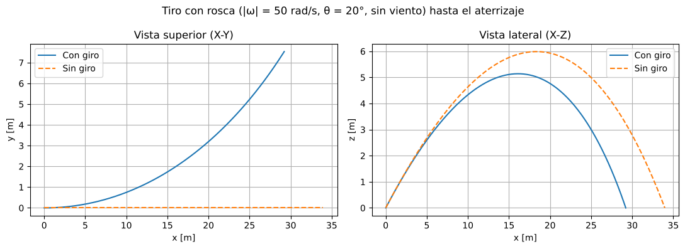
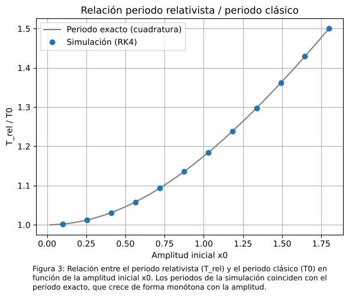
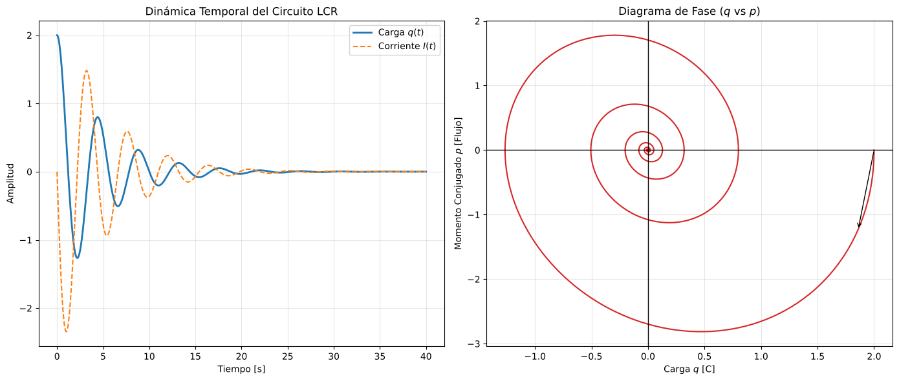

# Theoretical Mechanics II

**Abstract.** This folder gathers four projects in analytical mechanics and nonlinear dynamics. A magnetic pendulum with three attracting magnets has intertwined basins of attraction: the capturing magnet depends sensitively on the initial position, and the fraction of uncertain initial conditions scales as a power of the resolution, a signature of doubly transient chaos. A simulation of a spinning football includes drag and the Magnus force, is validated against the exact trajectory in vacuum, and quantifies how spin, spin-axis tilt and wind change the lateral deviation, height and range of a free kick. A relativistic harmonic oscillator integrated with a fourth-order Runge-Kutta scheme reproduces the exact period, computed by quadrature, to within 3 × 10⁻⁶ and shows how the period grows with amplitude as the speed saturates below c. Finally, electrical circuits are described with the Lagrangian and Hamiltonian formalisms, including dissipation through the Rayleigh function, an energy-balance check, and the Josephson junction as a nonlinear inductor.

## Contenido

| Notebook | Tema |
|---|---|
| [`magnetic_pendulum_chaotic_dynamics.ipynb`](magnetic_pendulum_chaotic_dynamics.ipynb) | Péndulo magnético: cuencas de atracción y caos transitorio |
| [`magnus_effect_simulation.ipynb`](magnus_effect_simulation.ipynb) | Efecto Magnus en un balón de fútbol, con arrastre y viento |
| [`relativistic_harmonic_oscillator.ipynb`](relativistic_harmonic_oscillator.ipynb) | Oscilador armónico relativista y su periodo exacto |
| [`lagrangian_hamiltonian_formulations_for_electrical_circuit_analysis.ipynb`](lagrangian_hamiltonian_formulations_for_electrical_circuit_analysis.ipynb) | Circuitos eléctricos con los formalismos de Lagrange y Hamilton |

## Péndulo magnético

Una masa puntual suspendida de un pivote fijo se mueve bajo la gravedad, una fricción viscosa y la atracción de tres imanes situados en los vértices de un triángulo equilátero, justo por debajo del punto más bajo de su trayectoria. Las trayectorias se integran con el método de Euler-Cromer con restricción geométrica explícita, vectorizado con NumPy para seguir a la vez decenas de miles de condiciones iniciales.

- La energía potencial tiene tres pozos junto a los imanes y un equilibrio inestable en el centro; toda trayectoria termina en reposo junto a uno de los tres imanes.
- El mapa de cuencas de 40 000 condiciones iniciales muestra franjas entrelazadas, y dos posiciones de partida separadas 1 mm pueden terminar en imanes distintos.
- La fracción de condiciones iniciales inciertas escala como $f(\varepsilon) \propto \varepsilon^{\alpha}$, con $\alpha = 0.74$ entre 0.3 mm y 1 cm, como corresponde al caos doblemente transitorio de un sistema disipativo sin forzamiento.
- El mapa de cuencas cambia en menos del 2.1 % de los puntos al reducir el paso de tiempo a la mitad.

## Efecto Magnus

El balón se modela como una esfera sometida a la gravedad, al arrastre aerodinámico y a la fuerza de Magnus, con un coeficiente de sustentación proporcional al parámetro de giro. Las trayectorias se integran con `solve_ivp`, con un evento que detecta el contacto con el suelo.

- Sin aire, el tiempo de vuelo y el alcance numéricos coinciden con los exactos en nueve cifras decimales; el arrastre reduce el alcance de 48.9 m a 34.0 m.
- Un tiro con 50 rad/s y el eje de giro inclinado 20° se desvía 7.5 m lateralmente en un alcance de 29.2 m.
- Los barridos de parámetros muestran que la componente vertical del giro fija la desviación lateral, que la inclinación del eje decide qué parte de la fuerza de Magnus actúa en la vertical, con lo que cambian la altura, el alcance y el tiempo de vuelo, y que el viento frontal intensifica el efecto, mientras que el lateral añade una deriva debida sobre todo al arrastre.

## Oscilador armónico relativista

Se integra con el método RK4 la ecuación de movimiento de una partícula sometida a una fuerza restauradora lineal en relatividad especial, $\dot v = -\omega^2 x/\gamma^3$, en unidades con $c = \omega = 1$. El integrador se compila con Numba cuando está disponible, y el barrido en amplitud se reparte entre los núcleos del procesador.

- Para $x_0 = 1.5$ el periodo es $8.578455 \pm 0.000498$, un 36.5 % mayor que el clásico, y coincide con el periodo exacto calculado por cuadratura, 8.578422. En todo el barrido, la desviación relativa máxima entre ambos es $2.8\times10^{-6}$.
- La velocidad máxima, $0.882\,c$, coincide con la que fija la conservación de la energía y se acerca a $c$ sin alcanzarla al aumentar la amplitud.
- El integrador muestra convergencia de cuarto orden y conserva la energía con errores relativos del orden de $10^{-13}$, comparables al redondeo acumulado.

## Circuitos eléctricos con los formalismos de Lagrange y Hamilton

La carga del capacitor hace de coordenada generalizada, la inductancia de masa y la resistencia entra mediante la función de disipación de Rayleigh. Se obtienen las ecuaciones de los circuitos LC y LCR, se integran las ecuaciones de Hamilton y se construye el retrato de fase.

- Las simulaciones con `odeint` y con `solve_ivp`, esta última con valores típicos de laboratorio en unidades SI, reproducen la solución analítica del circuito subamortiguado con errores relativos de $4\times10^{-8}$ y $7\times10^{-9}$.
- El balance $H(t) + \int_0^t R I^2\,dt' = H(0)$, forma integrada de $\dot H = -RI^2$, se cumple con una discrepancia de $2\times10^{-8}$ de la energía inicial.
- La juntura de Josephson se presenta como un inductor no lineal: tomando como coordenada la diferencia de fase entre los superconductores, el circuito equivale a un péndulo, cuya anarmonicidad es la base de los qubits superconductores.

## Ejecución

Requiere Python 3 con `numpy`, `scipy`, `matplotlib` y `pandas`. `numba` es opcional y acelera el notebook del oscilador relativista. Cada notebook se ejecuta en orden desde un kernel limpio y tarda menos de un minuto. El de circuitos guarda sus figuras en la subcarpeta `figs_rlc`, que se crea al ejecutarlo.
